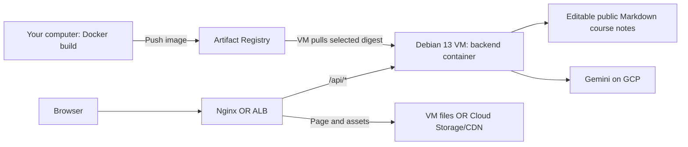
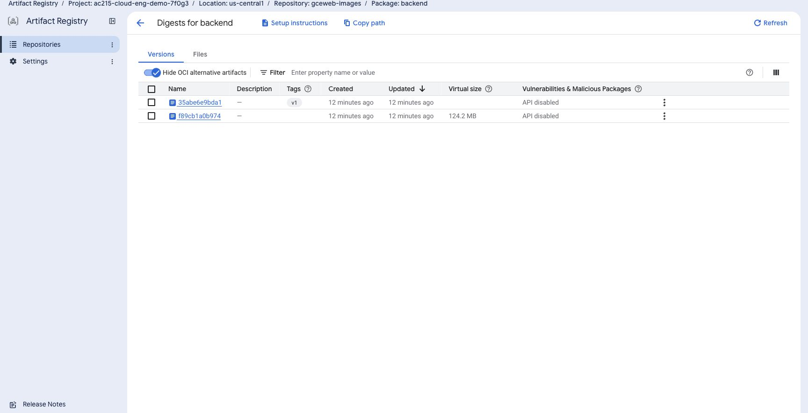

# AC215 course website

The course website runs on [GitHub Pages](https://harvard-iacs.github.io/AC215-new-site/). Push changes to `main` to build and publish it automatically. See [publishing and local preview](docs/github-pages.md).

The default website is static and needs no backend. The full FastAPI backend and chatbot code are included, with chat disabled. The optional Google Cloud tutorial below enables chat for its deployment lab.

For local development, run these commands from the repository folder:

```bash
npm ci --prefix frontend
npm run dev --prefix frontend
```

## Google Cloud deployment tutorial

Build the AC215 course site with a React/Vite frontend and a Python FastAPI backend. Visitors can explore the course and ask questions about its editable public notes. The chatbot uses Gemini 3.8 Flash through the VM's attached service account.

You will deploy the same app in two layouts. **Create and configure cloud resources in Google Cloud Console.** Use your computer’s terminal to build the container image, push it to Artifact Registry, and connect to the VM through IAP.

## What you’ll learn

1. Build the React/Vite frontend into static files in `dist/`.
2. Create the network, access permissions, and Artifact Registry repository in Console.
3. Build a backend image locally and push it to the registry.
4. Create a Debian 13 VM, then pull and run that exact image on it.
5. Deliver the frontend with either Nginx on the same VM, or Cloud Storage + ALB + CDN.
6. Check HTTP delivery, API health, caching, and VM hardening; then remove your lab resources in Console.

## Choose a deployment layout

| | Option A: Single VM + Nginx | Option B: VM backend + ALB/CDN |
| --- | --- | --- |
| Frontend | Nginx serves the built files on the VM | Cloud Storage stores the files; ALB and CDN deliver them |
| API | Nginx forwards `/api/*` to the local container | ALB forwards `/api/*` to the VM container |
| Public entry | Nginx HTTP on port 80 | Global ALB HTTP on port 80 |
| Backend image | Pulled from Artifact Registry | The same image, pulled from Artifact Registry |
| VM OS and hardening | Debian 13; shared host/container baseline | Debian 13; shared host/container baseline |
| Guide | [Deploy with Nginx](docs/deploy-single-vm.md) | [Deploy with ALB and CDN](docs/deploy-alb-cdn.md) |

Start with Option A to follow the full request through one VM. If you complete both, reuse the VM: verify Option A, then follow the transition steps in Option B before creating its load balancer and bucket. Both layouts use one backend VM. Chat conversations are temporary. Gemini uses a persistent daily spending ledger.

## Prerequisites

On your computer:

- [Docker Desktop](https://docs.docker.com/desktop/setup/install/) running, or Docker Engine on Linux.
- [Node.js](https://nodejs.org/en/download) **22.23.4** and npm, recorded in [frontend/.nvmrc](frontend/.nvmrc).
- [Python 3.12](https://www.python.org/downloads/) available as `python3`. The deployment helpers use it on your computer. Running the backend locally is optional.
- Bash, curl, and the [Google Cloud CLI](https://docs.cloud.google.com/sdk/docs/install). On Windows, use [WSL2](https://learn.microsoft.com/en-us/windows/wsl/install) with Docker Desktop integration and run the commands in its Linux terminal.
- No model-provider key is needed for Gemini on the VM. The local access JSON for registry push and IAP SSH remains part of the chosen cloud access setup.

For Google Cloud:

- A new, dedicated project with billing and permission to configure its resources through Console. Your instructor or administrator can prepare it.
- Permission to reserve a public IPv4 for each selected layout. The deployment guides show when to create these addresses.
- For Option B, an approved project that permits a public frontend bucket.

Complete the [cost worksheet](docs/cost-worksheet.md) and set a cleanup time before creating resources. Create a project-scoped alerts-only budget in Console → **Billing → Budgets & alerts**. An alert does not cap spending. [Budget behavior](https://docs.cloud.google.com/billing/docs/how-to/budgets).

## How to follow the walkthrough

Start with Option A. Complete it before moving to Option B with the same VM.

| Order | Read and complete | Stop when |
| --- | --- | --- |
| 1 | README Steps 1–2 | The frontend is built and `config.env` is prepared |
| 2 | [Shared Console setup](docs/provisioning.md), Steps 1–6 | Accounts, model access, repository, network, and IAP firewall exist |
| 3 | [Configure the local account](docs/access.md#configure-the-local-account) only, then README Step 4 | Authentication succeeds and the image digest appears in Artifact Registry |
| 4 | [Shared Console setup](docs/provisioning.md#step-7-create-the-debian-13-vm), Steps 7–9 | The VM reports Bootstrap ready and Docker server details |
| 5 | [Option A](docs/deploy-single-vm.md), then [verification](docs/verify.md) | The website and Gemini chat work at the VM's HTTP address |
| 6 | [Option B](docs/deploy-alb-cdn.md), then [verification](docs/verify.md) | The website and Gemini chat work at the ALB's HTTP address |
| 7 | [Cleanup](docs/cleanup.md) | The lab VM, IPs, images, bucket, and load balancer are removed |

## Contents

- [How the app works](#how-the-app-works)
- [Step 1: Build the frontend](#step-1-build-the-frontend)
- [Step 2: Set the lab names](#step-2-set-the-lab-names)
- [Step 3: Create resources in Console](#step-3-create-resources-in-console)
- [Step 4: Build and push the backend image](#step-4-build-and-push-the-backend-image)
- [Step 5: Deploy your chosen layout](#step-5-deploy-your-chosen-layout)
- [Step 6: Verify and clean up](#step-6-verify-and-clean-up)
- [Project files](#project-files)

## How the app works

The frontend uses **React, Vite, shadcn controls, and Three.js**. The build creates twelve complete readable pages, including supplementary readings and five full milestone instruction sets. The main navigation contains: Home, Schedule, Policy, Tutorials, FAQs, and Project Showcase. The showcase is marked Coming soon. On Home, an original solid architectural scene, based on SEC references, responds to scrolling and Light/Dark/System themes. The header pairs the Harvard shield with AC 215 and links to the separate pages.

The **Python 3.12 FastAPI backend** reads four public Markdown notes in `backend/knowledge/`: `general.md`, `lectures.md`, `milestones.md`, and `project.md`. `catalog.json` lists their titles, descriptions, and update date. These editable files are the course guide's knowledge. Gemini chooses relevant notes and streams an answer from them. All visitors share a $10 daily model budget.

Students use [Ed Discussion](https://edstem.org/us/courses/97373/discussion) for course questions and [Ed Lessons](https://edstem.org/us/courses/97373/lessons) for lecture materials. Ed requires course access.

The cloud deployment has an image delivery path and an application request path:



The registry stores backend images. It does not run the app or serve its web page. The VM pulls an image during deployment and runs it with Docker. The frontend is a separate build of public HTML, JavaScript, and CSS.

Each layout uses one HTTP address for the page and `/api/...`. `GET /api/health` checks the backend. `GET /api/course` lists the course files; allowlisted `/api/course/files/{filename}` URLs return their public text. The floating chat uses `POST /api/chat/stream` to display live file-read activity and an answer. See the [course Q&A guide](docs/providers.md) for response modes and limits.

The repository's default frontend build is the static course website, with chat disabled. This GCP tutorial enables the retained chat implementation explicitly with `VITE_ENABLE_CHAT=true` in the build command below. Both versions keep the full backend code in the repository.

The chat button expands into a floating window at the bottom right. Minimize preserves its draft and temporary turns. Clear, reload, or navigation to another page discards them. Those turns stay in React memory. Every server request contains only the current question.

The header stays visible while scrolling. The browser remembers the selected theme and the scene’s Pause/Resume setting on the same site. These preferences are separate from chat. Supported browsers animate page changes and the chat window. Reduced-motion settings use immediate transitions or still scene views.

For the GCP lab, enable the model API, grant the existing VM runtime account permission to invoke it, and select `gemini` in the deployment command. The backend obtains short-lived credentials from VM metadata. It needs no Gemini key, runtime JSON key, or secret `.env` file.

Gemini requests are billed to the GCP project. Add that usage to the [cost worksheet](docs/cost-worksheet.md). Use only non-sensitive public course questions over this HTTP lab connection. See the [course Q&A guide](docs/providers.md) for the file-reading flow and daily allowance.

This course-site revision has not yet been validated on Google Cloud. The [validation record](docs/validation.md) separates its current checks from historical infrastructure checks.

---

## Step 1: Build the frontend

Clone or download the course repository supplied by your instructor. From its root, open this tutorial:

```bash
cd tutorials/gcp-compute-engine-web
```

If your download contains only this tutorial, open its `gcp-compute-engine-web` folder instead. You should see `backend/`, `frontend/`, and `scripts/`.

**Your computer — tutorial folder:**

```bash
npm ci --prefix frontend
VITE_ENABLE_CHAT=true npm run build --prefix frontend
```

The build creates `frontend/dist/`:

```text
frontend/dist/
├── index.html
├── schedule.html
├── policy.html
├── tutorials.html
├── faqs.html
├── showcase.html
├── readings.html
├── milestone1.html  # also milestone2.html through milestone5.html
├── 404.html
├── 404.css
├── favicon.svg
├── sec-poster-light.png
├── sec-poster-dark.png
├── classroom-poster-light.png
├── classroom-poster-dark.png
├── theme-init.js
├── showcase-poster-session.webp
├── brand/           # SEAS logo
├── assets/          # Built JavaScript and CSS
├── fonts/           # Public fonts
├── milestones/      # Public instruction images
└── staff/           # Public course staff images
```

Deploy the **entire contents** of this directory, preserving its subfolders. Nginx serves them in Option A; Cloud Storage holds them in Option B. Each generated HTML file contains its readable page before JavaScript starts. Page links request real `.html` files, so they need no frontend routing server or URL rewrites. You do not need a running frontend development server or a model API key to build these files.

Keep backend secrets and credentials out of `frontend/` and `dist/`. Anything included in a static frontend build can be downloaded by its users.

**Checkpoint:** `frontend/dist/index.html` and the `assets/` folder exist. Continue to cloud setup. [Optional local development](docs/development.md#run-the-app-locally-optional) is separate from this deployment workflow.

---

## Step 2: Set the lab names

**Your computer — tutorial folder:**

```bash
cp config.env.example config.env
```

Open `config.env` and replace the placeholders. These names must match the fields you enter in Console:

```dotenv
PROJECT_ID=your-globally-unique-project-id
REGION=us-central1
ZONE=us-central1-a
PREFIX=gceweb
DOMAIN=
DEPLOYMENT_MODE=single-vm
BUCKET=your-globally-unique-project-id-web-public
ACCESS_SERVICE_ACCOUNT=gceweb-access@your-globally-unique-project-id.iam.gserviceaccount.com
SERVICE_ACCOUNT_KEY_FILE=secrets/gcp-service-account.json
```

| Value | Meaning |
| --- | --- |
| `PROJECT_ID` | Your dedicated project’s actual ID |
| `REGION` / `ZONE` | Use `us-central1` / `us-central1-a` unless your course specifies another location |
| `PREFIX` | Resource prefix; the guides use `gceweb` in Console fields |
| `DOMAIN` | Public IPv4 or DNS hostname, without `https://` or a path; set after reserving the address |
| `DEPLOYMENT_MODE` | `single-vm` for Option A; `alb-cdn` for Option B |
| `BUCKET` | A globally unique bucket name for Option B |
| `ACCESS_SERVICE_ACCOUNT` | Local access identity created in the shared Console guide |
| `SERVICE_ACCOUNT_KEY_FILE` | Local path to its JSON key; keep the contents out of this configuration |

If you change `PREFIX`, replace `gceweb` in all Console resource names. The scripts derive the VM name `PREFIX-api`, SSH account `PREFIX-ssh`, and repository `PREFIX-images`. Keep `config.env` private and use it as your lab record; it is ignored by Git.

If the project has not been created yet, prepare the location and resource names now. Fill `PROJECT_ID`, the account email, and the bucket name after copying the actual project ID in the shared guide's Step 1. Complete these values before running the authentication or image-build helpers.

The [script guide](docs/scripts.md) explains every deployment helper, its inputs, changes, and result.

## Step 3: Create resources in Console

Complete **Steps 1–6** of [Create the shared resources in Console](docs/provisioning.md). They cover:

1. Project, billing, and APIs.
2. The local access, keyless SSH, and VM runtime accounts.
3. A Docker repository in Artifact Registry, with separate image-writer and image-reader permissions.
4. VPC, subnet, and the IAP firewall rule.

Complete only [Configure the local account](docs/access.md#configure-the-local-account) to activate your local access key. The VM is created later.

```bash
./scripts/00-auth.sh
```

This checks that the JSON key belongs to the configured account, activates it in gcloud’s local credential store, and confirms authentication. It does not grant permissions. Read [what the authentication script does](docs/scripts.md#local-authentication-00-authsh). Leave `DOMAIN` empty for now; an address is not needed to build and push the image. Create the VM after the image is in the registry.

**Checkpoint:** Console shows the three service accounts, Gemini runtime grant, Docker repository, custom VPC/subnet, and IAP rule. The local access account is authenticated. Continue to Step 4 here.

## Step 4: Build and push the backend image

**Your computer — tutorial folder, Docker running:**

```bash
./scripts/build-push.sh v1
```

The helper configures Docker’s credential helper for your regional registry host, builds the backend for `linux/amd64`, and pushes it. On an ARM Mac, Docker uses emulation for that target. Credentials are not Docker build inputs. See [the build/push steps and local files they change](docs/scripts.md#backend-image-delivery-build-pushsh-version).

The image name follows:

```text
REGION-docker.pkg.dev/PROJECT_ID/PREFIX-images/backend:v1
```

Open **Artifact Registry → your repository → backend** in Console. Confirm that version `v1` and its digest appear.

The helper writes the digest-pinned reference to `.build/image-ref.txt`:

```text
REGION-docker.pkg.dev/PROJECT_ID/PREFIX-images/backend@sha256:DIGEST
```

A tag is a release label; a digest identifies the exact image content. The VM deploys the digest. For a later change, use a new tag such as `v2`, inspect it in Console, and redeploy. Continue only after the helper prints **Pinned VM image**.

**Checkpoint:** Console shows your uploaded image and the local digest reference was written. The VM has not built the image; it will pull this version.



Docker Buildx can show an image index and its platform image as separate entries. Use the digest recorded in `.build/image-ref.txt` for deployment.

## Step 5: Deploy your chosen layout

Finish **Steps 7–9** of the [shared Console guide](docs/provisioning.md#step-7-create-the-debian-13-vm): create the Debian 13 VM with its hardening startup script and runtime identity, grant VM-scoped IAP access, and verify local IAP SSH. Confirm the bootstrap marker exists before deploying the image.

- **Option A:** [Single VM with Nginx](docs/deploy-single-vm.md). Create its public web firewall rule and regional IP in Console, install the registry image, configure Nginx, then check HTTP delivery.
- **Option B:** [VM backend with ALB and CDN](docs/deploy-alb-cdn.md). Create the instance group, bucket, ALB, and routing in Console; upload the static files through the bucket UI.

Each guide labels **Console**, **Your computer**, and **Inside the VM** steps and gives the expected result. Commands on the VM install and run software; resource creation stays in Console.

## Step 6: Verify and clean up

After HTTP delivery works, follow [Verify the app](docs/verify.md). Check all six pages, the selected Gemini model, streamed answers and file-read details, API health, cache policy, and firewall. Use only public course questions over HTTP.

Follow [Cleanup in Console](docs/cleanup.md) when you finish. It lists the resources and deletion order for each layout, including the Artifact Registry images, disks, reserved IPs, and service accounts. The backend has no user data to export.

## Project files

```text
gcp-compute-engine-web/
├── README.md                 # Start here
├── config.env.example        # Your Console names and local access settings
├── backend/                  # FastAPI, public Markdown notes, Dockerfile, and tests
├── frontend/                 # React/shadcn source and public build output
├── scripts/
│   ├── 00-auth.sh            # Authenticate the local access account
│   ├── ssh.sh                # Connect through IAP
│   ├── build-push.sh         # Build and push the backend image
│   ├── upload-vm-files.sh    # Transfer VM configuration through IAP
│   └── check-local.sh        # Local source syntax checks
├── vm/                       # Host setup, registry deployment, and Nginx config
├── docs/                     # Console steps, both layouts, checks, and cleanup
├── tests/                    # Local fixtures and checks
└── tools/                    # Maintainer automation
```

`frontend/dist/`, `.build/`, and `secrets/` are generated or private local directories and are ignored by Git.

For deeper details, see [architecture](docs/architecture.md), [course Q&A](docs/providers.md), [VM operations](docs/operations.md), [troubleshooting](docs/troubleshooting.md), and [development checks](docs/development.md). The [validation record](docs/validation.md) states which checks were local and which still require a real cloud deployment.
