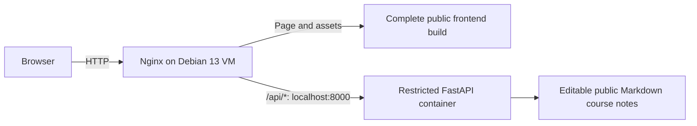
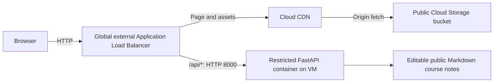

# How the two deployments work

[Back to the tutorial](../README.md)

Both layouts deliver the same six prerendered React/Vite course pages and run the same Python 3.12 FastAPI backend. They change where public frontend files live and which service receives HTTP requests.

## Image delivery

```text
Your computer: Docker build → Artifact Registry → VM: Docker pull → running container
```

Console creates the repository. The local access account has repository Writer. The VM’s attached runtime account has repository Reader and cloud-platform access scope. The VM obtains a short-lived token from its metadata service; the installer passes it to Docker on stdin and removes its temporary login files after pulling.

The deployment reference ends in `@sha256:DIGEST`. systemd uses `--pull=never` so routine restarts use the selected local image. To change versions, deploy another selected digest. [Registry authentication](https://docs.cloud.google.com/artifact-registry/docs/docker/authentication).

## Option A: Single VM with Nginx



Nginx serves `/var/www/ac215` and forwards the original API path and host/protocol headers to the container on VM loopback. The VM needs a stable regional external IP, public port 80, and the IAP SSH rule. You maintain the host, Docker, Nginx, image, and recovery.

## Option B: VM backend with ALB and CDN



The URL map selects a static backend bucket or the VM backend service. The unmanaged group supplies one VM and its named port; it does not autoscale or replace the VM. The global load balancer and bucket are managed services outside the VM’s subnet/zone placement.

CDN is enabled for static files and disabled for the API. The ALB-to-VM hop uses HTTP with source-restricted firewall rules. The VM’s external IP supports outbound package/registry access; the ALB reaches its internal address. No Cloud NAT resource is created.

Both layouts use one origin for the page and `/api/...`. There is no production frontend Node server. The build prerenders readable course HTML and includes local fonts, staff images, the SEAS logo, theme initialization, and day/night scene posters. JavaScript enhances the page with the floating chat and a solid reference-based Three.js architectural scene.

## The API and editable course notes

`GET /api/health` returns `{"status":"ok"}`. `GET /api/course` returns metadata and the file catalog. `GET /api/course/files/{filename}` serves allowlisted public note text. The four Markdown notes in `backend/knowledge/` and `catalog.json` are the guide’s current knowledge.

`POST /api/chat/stream` accepts a JSON question and emits server-sent events for start, file reads, the answer, or an error.

The GCP tutorial selects `COURSE_PROVIDER=gemini`. The backend uses the attached VM account's short-lived metadata token to call Gemini 3.8 Flash at the global endpoint. The shared Console setup enables the model API and grants the runtime account permission to invoke it.

Gemini selects up to three files through `read_course_files`, then makes a second request to stream an answer when relevant notes exist. The backend enforces the course-only instructions, file allowlist, and daily spending limit. [Course-guide details](providers.md).

The paid mode stores daily spend totals in a persistent SQLite ledger. The VM service mounts `/var/lib/gce-web-budget/ledger` at `/app/data` so those totals survive container restarts and image updates. Notes preview does not write a spending ledger.

The browser saves the theme and scene Pause/Resume preferences in local storage for the current origin. A different scheme, hostname, or port has separate preferences. Temporary chat turns and the draft stay in React memory. Minimize preserves them. Clear, reload, or navigation to another document discards them. The backend receives only the current question and starts an independent run. Notes are bundled in the backend image. Edit them and update `catalog.json`, then rebuild and redeploy to publish changes.

## Cache and routing policy

| Response | Policy in both layouts |
| --- | --- |
| Hashed `/assets/*` files | `public,max-age=31536000,immutable` |
| HTML and other public files | `no-store,max-age=0` |
| `/api/*`, including errors | `no-store`; no CDN caching |
| Missing static path | HTTP 404 |

There is no saved-chat URL or SPA pathname fallback. Nginx returns real missing-file errors; the bucket uses `index.html` and `404.html` as website pages. Deploy all files in `dist/`, preserving the folders.

Nginx adds browser security headers in Option A. Option B adds headers through the ALB static backend. Direct public bucket URLs do not pass through those headers. Only public build files belong in the bucket; never include credentials or `.env`.

## Access and operating boundaries

Your Google user creates resources in Console. The local access JSON key stays on your computer and is used for image push and keyless SSH impersonation. IAP and OS Login authorize administration. The attached VM identity supplies registry read access. [Access details](access.md).

The VPC is global, subnet regional, and VM/disk zonal. IAM authorizes identities; firewall rules limit reachability; container restrictions limit the process. One VM remains a single failure boundary. The static page can remain readable while the API fails, but Q&A needs the backend.

Use only public course questions over the HTTP lab connection. The GCP path needs no Gemini key or runtime JSON file. Model access and this course-site revision's cloud deployment still require the live checks listed in [validation](validation.md).
