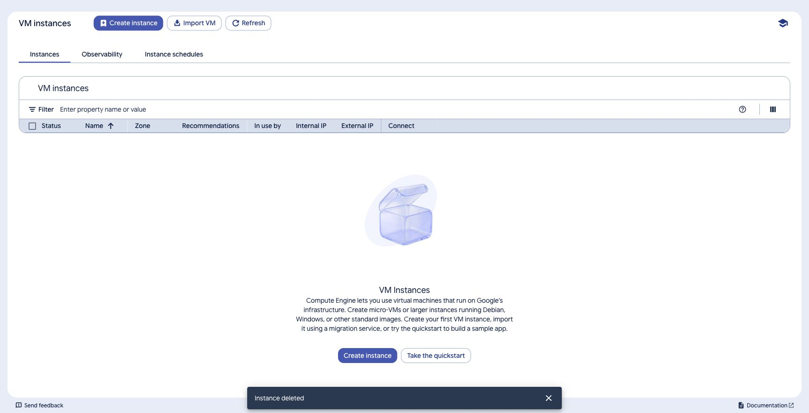
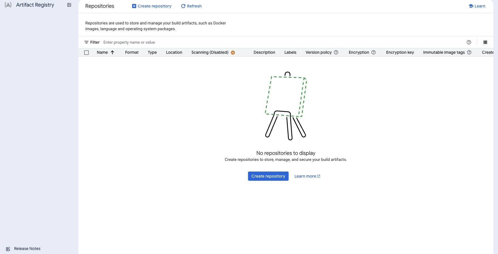
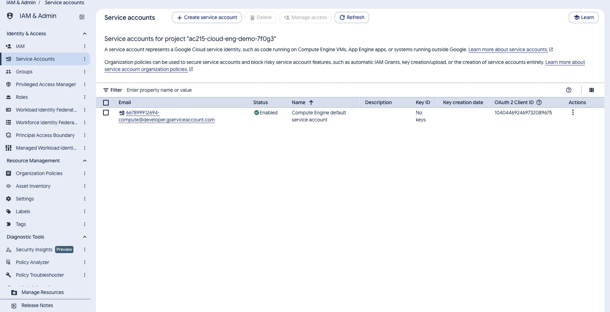

# Deployment validation — 2 November 2026

[Back to the documentation](../README.md)

**Result: both HTTP deployment layouts passed live checks, and the lab resources were removed.** One Debian 13 e2-medium VM in `us-central1-a`, with 4 GiB RAM and a 20 GiB standard boot disk, was reused sequentially. Resources were configured and deleted in Google Cloud Console. Local Docker and Google Cloud CLI commands handled the image and IAP connection.

This record describes the checks performed. Follow the [main tutorial](../../README.md) for the student procedure.

## Image and access

- Built the React/Vite frontend first. Built and pushed the generic `backend:v1` image for `linux/amd64`; confirmed it in Artifact Registry.
- Deployed digest `sha256:35abe6e9bda1ef69109b8757f8e02e0780e8611d3098b6b8374e7199e6fe1ca8`.
- Connected through IAP using the local access JSON identity and impersonated keyless SSH identity. The VM used its attached runtime identity to pull the image with a metadata-service token.
- No service-account JSON was copied into the VM, container image, frontend bucket, or deployment archive. Temporary registry credentials on the VM were removed.

## Live deployment checks

| Check | Option A: Nginx VM | Option B: ALB, bucket, CDN |
| --- | --- | --- |
| Public page `/` | 200; HTML, no-store | 200; HTML, no-store |
| `/api/health` | 200, `{"status":"ok"}` | Same |
| Unauthenticated `/api/sessions` | 401; no-store | Same |
| Missing `/lesson/intro` | 404 | 404 |
| Hashed assets | Immutable caching and security headers | All seven compiled assets matched local bytes; immutable caching |
| CDN reuse | Not applicable | Repeated JavaScript request returned `X-Cache-Status: hit` and `Age` |
| API CDN | Not applicable | Disabled; API remained no-store |
| Public VM port 8000 | Connection timed out; loopback bind | Connection timed out; proxy/health-check sources only |
| Backend service | Healthy restricted container | Console showed one healthy backend out of one |

The ALB routed `/api` and `/api/*` to the VM backend and used the frontend bucket as its default. Cloud Storage website index/error settings and object cache metadata were configured in Console. Cloud Armor's optional paid policy was not enabled.

The final single-VM check used public TCP 80 only. The final ALB frontend used HTTP on port 80. Password setup, real provider keys, private uploads, and model/search calls were not used on these public HTTP endpoints.

## Hardening and recovery

- Confirmed Debian 13, the selected machine/disk, Secure Boot, vTPM, and integrity monitoring. Startup metadata matched the checked-in script.
- Confirmed OS Login, blocked project SSH keys, disabled serial access, and effective SSH settings that reject root, password, and keyboard-interactive login. Unattended upgrades were enabled.
- IAP SSH ingress was restricted to `35.235.240.0/20`. ALB backend TCP 8000 ingress was restricted to `35.191.0.0/16` and `130.211.0.0/22`.
- Inspected the running container: user `10001:10001`, read-only root, dropped capabilities, no-new-privileges, 768 MiB memory and 64 process limits, temporary filesystem, and bounded logs.
- Verified service recovery and the same selected image after a VM stop/start. A request during startup briefly returned 502 before the backend became ready; subsequent health checks passed.

## Local checks

- Frontend production build passed.
- All **18 backend tests** and the production-container check passed in Docker with local protocol fixtures. Checks included authentication, private-key handling, provider catalogs, document parsing, streaming, SQLite persistence, runtime restrictions, and excluded private files. No paid provider requests were made.
- All **26 deployment-helper tests** passed. They covered digest validation, metadata credentials, build-before-upload, push-before-VM setup, IPv4 rendering, IAP arguments, credential-free archives, and lifecycle failure handling.
- Shell, Python, and Node source checks passed. Final documentation checks covered relative links, heading anchors, balanced code fences, and Bash example syntax. Syntax checks do not execute the examples.

## Cleanup

Console removal and read-only resource checks confirmed removal of the VM and boot disk, ALB and related components, unmanaged group, frontend bucket, both reserved addresses, three lab firewall rules, custom subnet/network, and Artifact Registry repository.

The access JSON key was deleted in Console. Project roles for the lab SSH account were removed; all three lab service accounts were deleted. Their resource-scoped grants disappeared with the deleted resources/accounts. The default Compute Engine service account and project were retained.

Local JSON and experimental certificate/private-key files were removed. The isolated Google Cloud credential database was removed, the prior Docker registry helper setting was restored, and the matching lab-generated SSH pair was removed. The official SDK install remains available. The user confirmed that the temporary extension file-URL permission was turned back off.

## Scope and evidence limits

The user chose to omit certificates from the final lab. Earlier TLS research and scripts are [archived](../archive/tls-research-20261102/README.md); experimental certificates were revoked. No ALB HTTPS success is claimed.

HTTP status, asset bytes, headers, CDN reuse, and the firewall checks were verified with command-line requests. Automated Chrome navigation to the final HTTP app was blocked by the browser environment, so final HTTP visual rendering is not claimed. Console setup and cleanup screenshots are real website-content captures, excluding browser chrome and personal account controls.

This was a light functional check, not a load, availability, or penetration test. There were no cloud chat sessions, real model/search calls, or sensitive uploads. Billing was not settled at completion; see the [cost record](../cost-preflight-20261102.md).

Earlier local UI/application checks are retained in the [historical validation record](../archive/validation-before-final-20261102.md). They describe their own dated environments and do not extend the cloud claims above.
