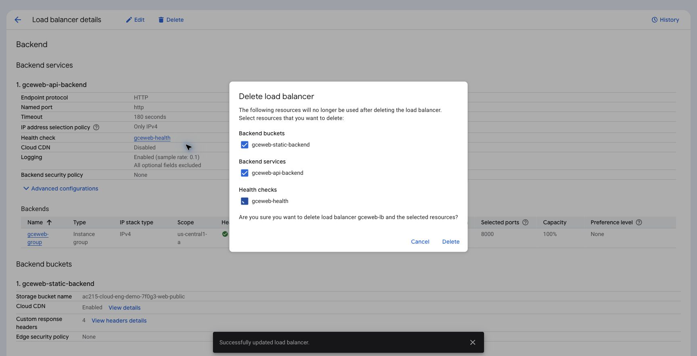
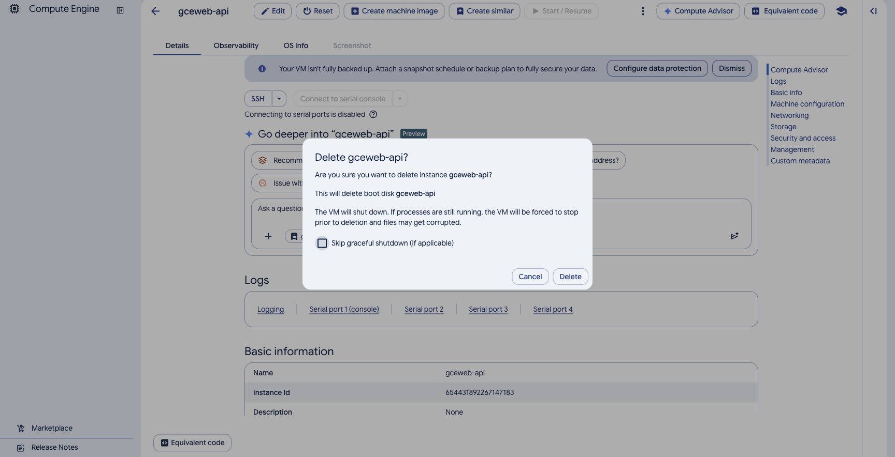
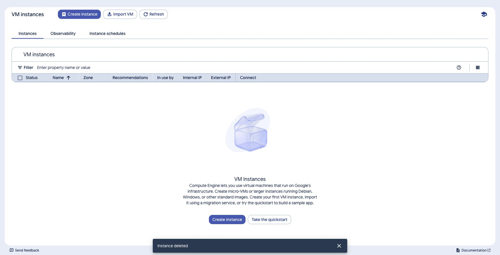
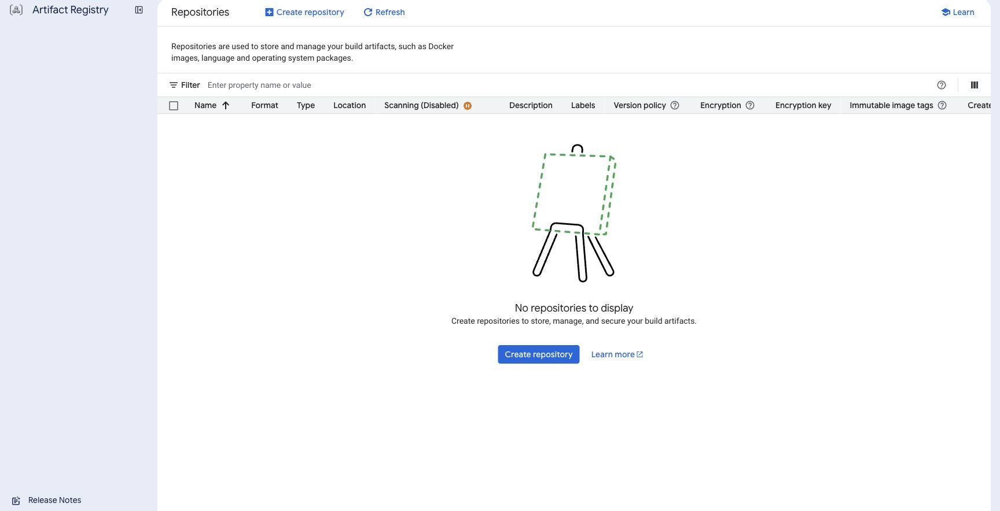
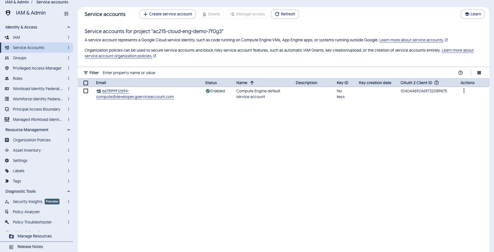

# Cleanup in Google Cloud Console

[Back to the tutorial](../README.md)

Save any deployment evidence you need first. The backend does not save chats. If you enabled paid chat, retain the spending ledger for any deployment that should carry forward the current daily cap. Use the dedicated project and your recorded prefix to identify this exercise’s resources.

Resource deletion is performed in **Console**. Check each selected resource’s name and project before confirming.

## Option A: Single VM

1. **Compute Engine → VM instances:** delete `gceweb-api` and select deletion of its attached lab boot disk.
2. **Disks:** confirm that boot disk was removed; inspect any remaining lab disks.
3. **VPC network → IP addresses:** release the regional reserved `gceweb-vm-ip` after it is detached.
4. **VPC firewall rules:** delete `gceweb-allow-web` and `gceweb-allow-iap`.
5. **VPC networks:** remove `gceweb-subnet`, then the `gceweb-vpc` network.
6. Complete the common registry, account, local-file, and billing checks below.

## Option B: ALB and CDN

Remove references before their targets:

1. **Load balancing:** open `gceweb-lb` and choose **Delete**. Review the list of frontend and backend resources it offers to remove, including its HTTP frontend.
2. **Load balancing → Frontends / Backends / Advanced:** inspect for remaining lab forwarding rules, target HTTP proxies, URL maps, `gceweb-api-backend`, and `gceweb-static-backend`. Remove leftover lab components after their references are gone. Use the details page to identify the generated resource names.
3. **Health checks:** delete `gceweb-health` after its backend service is removed.
4. **Compute Engine → Instance groups:** delete unmanaged group `gceweb-group`. Removing the group does not itself delete the VM.
5. **VM instances:** delete `gceweb-api` and its lab boot disk. Confirm the disk is gone in **Disks**.
6. **Cloud Storage:** delete the public frontend bucket and its objects.
7. **IP addresses:** release the global reserved `gceweb-ip` after forwarding rules are removed. Also release the regional `gceweb-vm-ip` retained when transitioning from Option A.
8. **VPC firewall rules:** delete `gceweb-allow-proxy` and `gceweb-allow-iap`.
9. **VPC networks:** remove `gceweb-subnet`, then `gceweb-vpc`.

Console can offer to delete related load-balancer components in one confirmation. Read that list, then check the named component pages for anything it retained. If a deletion is blocked by a dependency, remove the named referring lab resource first.

## Registry and service accounts

After either layout is removed:

1. **Artifact Registry → Repositories:** delete `gceweb-images`, including the images and versions created for this exercise. Registry storage remains allocated until those artifacts are deleted.
2. **IAM & Admin → IAM:** remove the lab's project role grants to `gceweb-ssh` and the `roles/aiplatform.user` grant to `gceweb-api`. Remove any lab IAP grants still shown for the deleted VM.
3. **IAM & Admin → Service Accounts:** remove the local access account’s Token Creator grant on `gceweb-ssh` and the SSH account’s Service Account User grant on `gceweb-api`, then delete those two lab accounts.
4. If `gceweb-access` was created only for this exercise, delete its cloud JSON key in its **Keys** tab, then delete that account. Keep an administrator-supplied shared account only as directed by its owner.

The registry permission grants are removed with the lab repository. Delete only the service accounts you created for this exercise; retain Google-managed service agents.

## Local files and final checks

- The HTTP lab has no certificate or DNS record to remove.
- After deleting the cloud key, remove its local JSON copy and remove the account from the local Google Cloud CLI credential store with `gcloud auth revoke YOUR_ACCESS_SERVICE_ACCOUNT`. Use the same configuration directory as the lab. Deleting a local file alone does not revoke a cloud key.
- Restore the prior Docker credential-helper entry for the regional registry host if this lab changed it. Remove an isolated lab credential directory after sign-out. Preserve your normal CLI and Docker settings.
- Remove the lab SSH key pair only if it was created exclusively for this exercise. A pre-existing `~/.ssh/google_compute_engine` key may be used by other VMs.
- Stop the local Vite and Uvicorn servers, or `backend-local` if you used the container. No application data volume is created.
- Remove an optional local `backend/.env` if you no longer need it; never include its contents in shared evidence.
- Check Console for remaining disks, reserved addresses, frontend buckets, Artifact Registry images, and load-balancer components.
- Review **Billing → Reports** after usage reporting catches up. Stopping a VM alone does not remove its disk, registry, or load-balancer costs.
- Revoke model-provider keys created only for the exercise when they are no longer needed.

The project, enabled APIs, budget alerts, and retained logs can remain after resource cleanup. If your course requires project deletion, follow its instructions after these checks.
