# Option B: VM backend with ALB and CDN

[Back to the tutorial](../README.md)

Console screenshots illustrate the shared workflow. Your image digest, frontend filenames, and object count will differ. Follow the fields and complete-file checks in the text.

Cloud Storage holds the public frontend files. A global external Application Load Balancer serves one HTTP address, with CDN enabled for static files and a separate uncached route to the backend VM.

```text
Browser → HTTP ALB → / and /assets/* → Cloud CDN → Cloud Storage
                    → /api/* → VM port 8000 → backend container
```

Complete the [shared Console setup](provisioning.md), set `DEPLOYMENT_MODE=alb-cdn` and `BUCKET` in `config.env`, and [build/push the backend image](../README.md#step-4-build-and-push-the-backend-image). Examples use prefix `gceweb`.

## Transition from Option A

If you completed Option A, reuse its VM, disk, three service accounts, repository, VPC, and subnet. Keep the selected image digest. You do not need a second VM or project.

1. Finish the Option A verification and save any evidence you need.
2. In Console → **VPC firewall rules**, delete only the lab rule **`gceweb-allow-web`**. Keep **`gceweb-allow-iap`**.
3. Connect through IAP.

**Your computer — tutorial folder**

```bash
./scripts/ssh.sh
```

**Inside the VM**

```bash
sudo systemctl disable --now nginx
exit
```

4. Keep the VM's attached regional IP for outbound access while doing Option B. The ALB gets a separate global frontend IP. Release both during final cleanup.
5. Change `DEPLOYMENT_MODE=alb-cdn` in your local `config.env`, then follow Step 1 below before changing the container's port binding.

Keep the spending-ledger directory on the reused VM. Complete final cleanup after both layouts.

## Step 1: Allow load-balancer traffic to the API

**Console → VPC firewall rules → Create firewall rule:**

| Field | Value |
| --- | --- |
| Name / network | `gceweb-allow-proxy` / `gceweb-vpc` |
| Priority | `1000` |
| Direction / action | Ingress / Allow |
| Target tags | `gceweb-api` |
| Source IPv4 ranges | `35.191.0.0/16`, `130.211.0.0/22` |
| Specified TCP ports | `8000` |

Save. These ranges apply to the selected global external ALB with instance-group backends and its health checks. [Firewall requirements](https://docs.cloud.google.com/load-balancing/docs/firewall-rules).

**Checkpoint:** For this lab VM, ingress rules allow port 22 from IAP and port 8000 from these two proxy/health-check ranges. There is no public VM web rule and no `0.0.0.0/0` rule for port 8000. The VPC's implied deny-ingress rule rejects other incoming traffic.

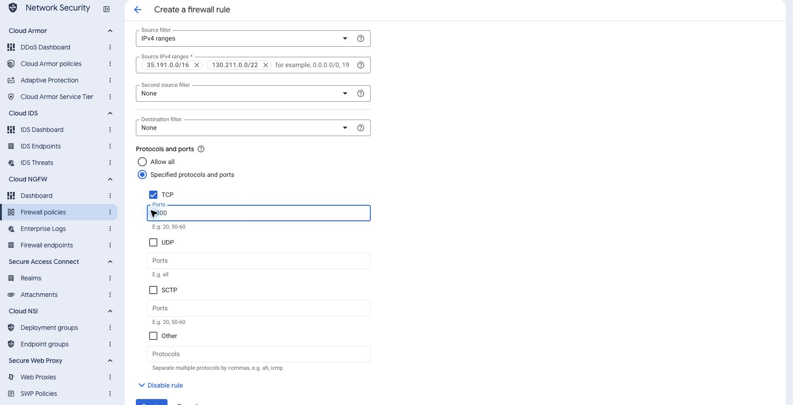

## Step 2: Pull and run the registry image

**Your computer — tutorial folder:**

```bash
./scripts/upload-vm-files.sh
./scripts/ssh.sh
```

The [transfer helper](scripts.md#vm-file-transfer-upload-vm-filessh) packs the VM configuration and image digest into `~/course-vm.tar.gz` and sends it through IAP. With `DEPLOYMENT_MODE=alb-cdn`, it omits the frontend because the bucket will serve those files. The [SSH helper](scripts.md#vm-connection-sshsh) then opens a shell on the VM using the keyless SSH identity.

**Inside the VM:**

```bash
mkdir -p ~/course-vm
tar -xzf ~/course-vm.tar.gz -C ~/course-vm
sudo bash ~/course-vm/vm/deploy-from-registry.sh \
  "$(cat ~/course-vm/image-ref.txt)" alb-cdn gemini
sudo docker inspect --format '{{.Config.Image}}' gce-web-api
curl --fail http://127.0.0.1:8000/api/health
```

Unpacking makes the installation files available in `~/course-vm`. The [registry installer](scripts.md#backend-installation-deploy-from-registrysh-image-layout-gemini) pulls the pinned image, creates a release, installs the systemd service and layout/model settings, restarts the container, and polls local API health. The `alb-cdn` argument selects the port binding; `gemini` selects the VM-identity model connection and persistent spending ledger.

Expect **Registry image is running**, the selected Artifact Registry digest, and `{"status":"ok"}`. This profile publishes VM port 8000 to the container for the load balancer. Its network firewall uses the source ranges from Step 1.

The attached runtime account supplies the temporary registry token. Its repository Reader grant and the VM’s cloud-platform access scope permit the pull; no JSON key is installed on the VM. Type `exit` to return to your computer.

## Step 3: Create an unmanaged instance group

**Console → Compute Engine → Instance groups → Create instance group:**

1. Choose **New unmanaged instance group**.
2. Name: `gceweb-group`.
3. Region/zone: the VM’s region and zone.
4. Network/subnet: `gceweb-vpc` / `gceweb-subnet`.
5. Select the existing `gceweb-api` VM.
6. Before creating the group, expand **Port mapping → Add port**: name **`http`**, port **`8000`**. Create the group and confirm it contains the one existing VM.

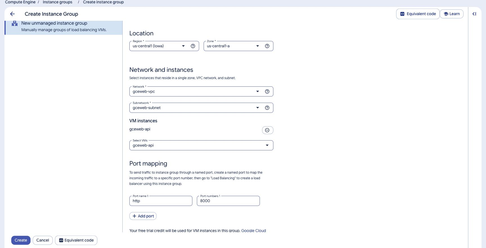

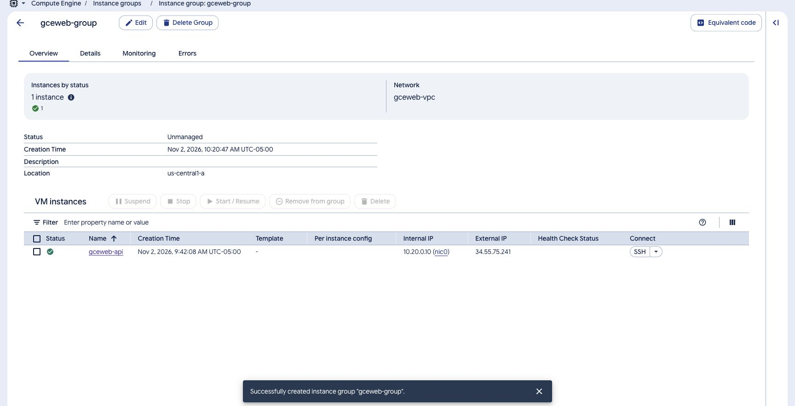

The named port tells the ALB which application port to use. It does not create a firewall rule. An unmanaged group does not autoscale or replace the VM. [Instance groups and named ports](https://docs.cloud.google.com/compute/docs/instance-groups/creating-groups-of-unmanaged-instances).

## Step 4: Create and upload the frontend bucket

**Console → Cloud Storage → Buckets → Create:**

| Field | Value |
| --- | --- |
| Name | Your globally unique `BUCKET` value |
| Location | Region: `us-central1` |
| Storage class | Standard |
| Access control | Uniform |
| Public access prevention | Initially enforced while you prepare the bucket |
| Soft delete | Disabled for this disposable build bucket |

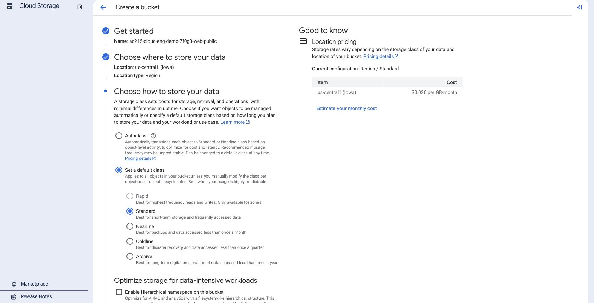

Create the bucket. If project/organization policy prevents public access, resolve an approved deployment with your administrator.

Use the `frontend/dist/` output built in README Step 1. Rebuild only if its source changed. The bucket must contain public frontend files only; never upload the source repository, service-account JSON, backend `.env`, or private keys.

Open **Permissions → Remove Public Access Prevention** and confirm for this bucket. Then choose **Grant access**, add principal **`allUsers`**, select **Storage Object Viewer**, save, and confirm **Allow Public Access**.

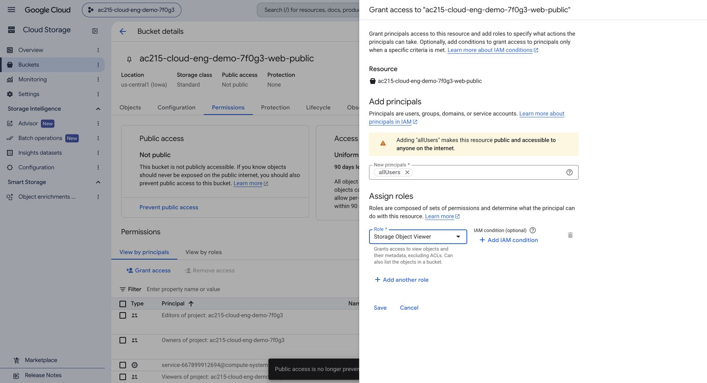

**Console → bucket → Objects:**

1. Use **Upload folder** for **every folder** inside `frontend/dist/`: `assets/`, `fonts/`, `staff/`, `brand/`, `milestones/`, and the `readings/` and `milestone1/` through `milestone5/` compatibility folders. Preserve each folder name at the bucket root.
2. Use **Upload files** for **all root files** inside `frontend/dist/`, including all twelve page files (`index.html`, `schedule.html`, `policy.html`, `tutorials.html`, `faqs.html`, `showcase.html`, `readings.html`, and `milestone1.html` through `milestone5.html`), `404.html`, `404.css`, `favicon.svg`, both SEC posters, both classroom posters, `showcase-poster-session.webp`, and `theme-init.js`. The site uses these explicit HTML addresses, so the bucket needs no directory URL rewrite. Upload the HTML files after their assets, with `index.html` last.
3. Compare the bucket tree with the complete local `frontend/dist/` tree. Keep all files and relative paths, with no outer `dist/` folder. The logo, staff images, fonts, theme script, and day/night posters are needed by the page; uploading only JavaScript/CSS and HTML is incomplete.
4. In the bucket list, open the bucket’s overflow menu → **Edit website configuration**. Set main page **`index.html`** and error page **`404.html`**. Save.

[Website configuration in Console](https://docs.cloud.google.com/storage/docs/hosting-static-website).

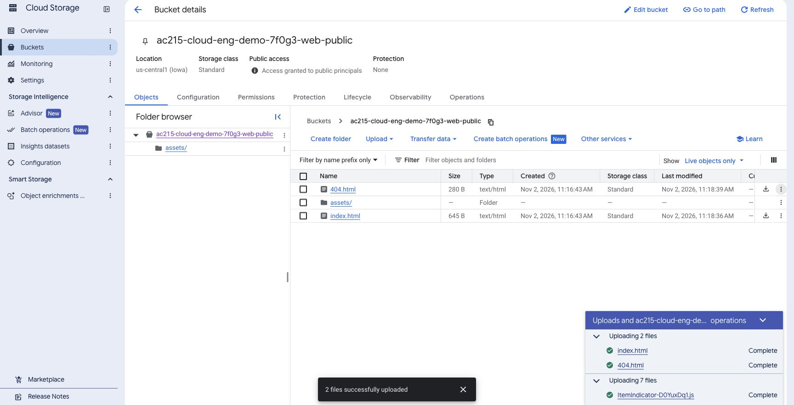

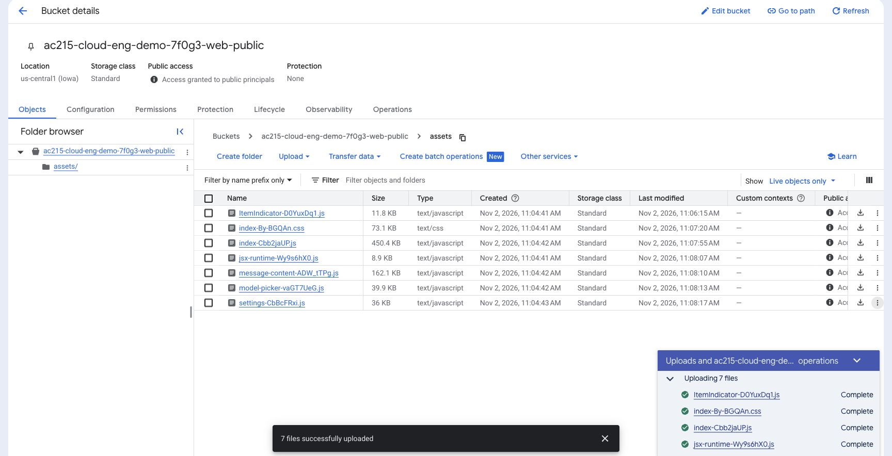

### Set the object metadata

For each uploaded object, use its overflow menu → **Edit metadata**. Set **Cache-Control** as follows:

| Objects | Cache-Control |
| --- | --- |
| `assets/*` | `public,max-age=31536000,immutable` |
| Every other object, including HTML, root SVG/PNG/CSS/JS, `fonts/*`, `staff/*`, and `brand/*` | `no-store,max-age=0` |

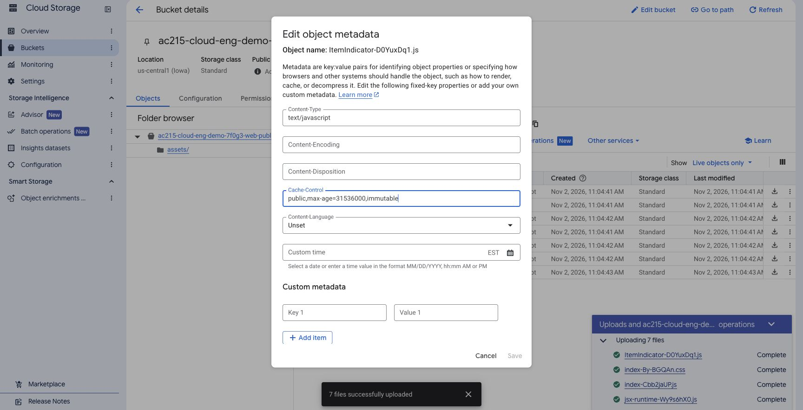

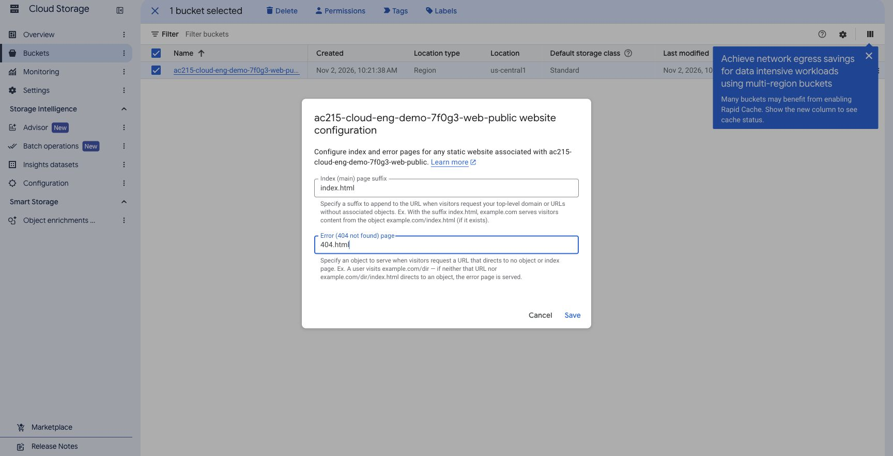

Check Content-Type: HTML for `.html`, JavaScript for `.js`, CSS for `.css`, SVG for `.svg`, and the appropriate font/image type for the other files. Console normally detects these during upload. The public bucket’s default cache policy is not the policy used for this lab, so set the values explicitly. [Edit metadata](https://docs.cloud.google.com/storage/docs/viewing-editing-metadata), [cache behavior](https://docs.cloud.google.com/cdn/docs/caching).

## Step 5: Reserve the load-balancer IPv4

**Console → VPC network → IP addresses → Reserve external static IP address:**

| Field | Value |
| --- | --- |
| Name | `gceweb-ip` |
| Network tier | Premium |
| IP version | IPv4 |
| Type | **Global** |

Reserve and record the address. This global frontend IP is separate from the VM’s outbound external IP.

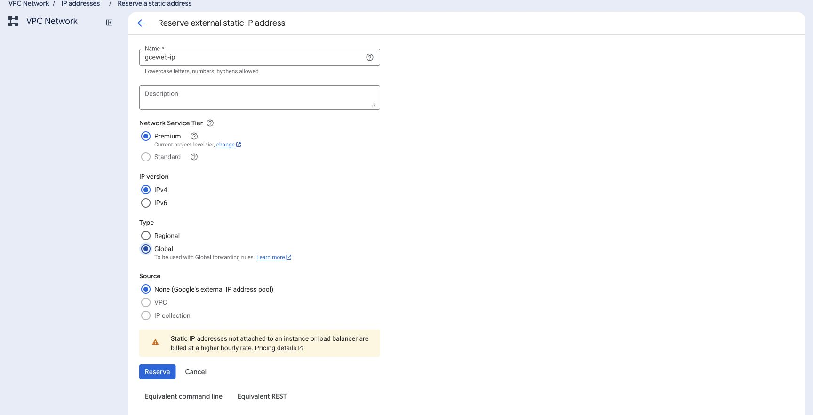

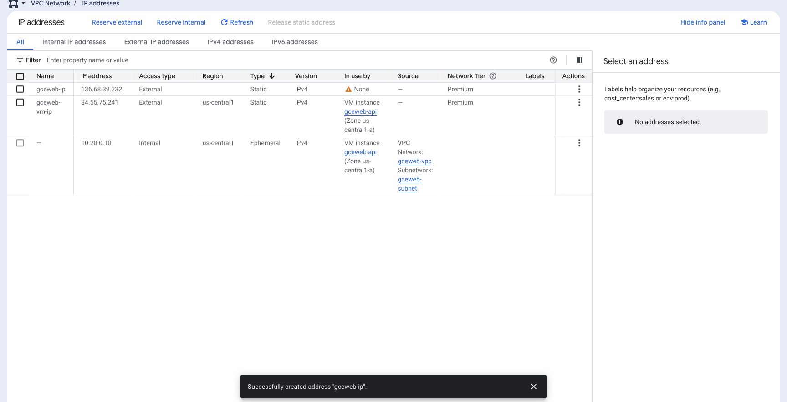

## Step 6: Create the ALB and its two backends

Use Console search to open **Load balancing → Create load balancer**. Select:

1. **Application Load Balancer (HTTP/HTTPS)**.
2. **Public facing (external)**.
3. **Best for global workloads**.
4. **Global external Application Load Balancer**.
5. **Configure**; name it `gceweb-lb`.

[Global external ALB configuration](https://docs.cloud.google.com/load-balancing/docs/https/setup-global-ext-https-compute).

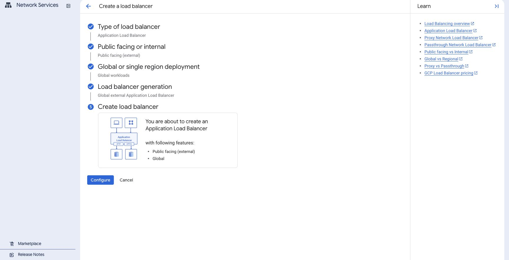

### Create the API backend service

In **Backend configuration → Backend services & backend buckets**, create a backend service:

| Field | Value |
| --- | --- |
| Name | `gceweb-api-backend` |
| Backend type | Instance group |
| Protocol / named port | HTTP / `http` |
| Backend instance group | `gceweb-group` |
| Port | `8000` |
| Balancing mode | Utilization, maximum `80%` |
| Timeout | `180` seconds |
| Cloud CDN | Disabled |
| Logging | Enabled; sample rate `0.1` |
| Cloud Armor backend security policy | **None** for this cost-bounded lab |
| Cloud Armor edge security policy | None |

Console can prefill port `8000` from the group’s named port. Keep one entry; do not add a duplicate. Disable the API backend’s default Cloud CDN selection. The default Cloud Armor policy is also a paid option; choose **None** for this lab.

Create a new health check from that form:

| Field | Value |
| --- | --- |
| Name | `gceweb-health` |
| Protocol / port | HTTP / `8000` |
| Request path | `/api/health` |
| Interval / timeout | `10` seconds / `5` seconds |
| Healthy / unhealthy thresholds | `2` / `3` |

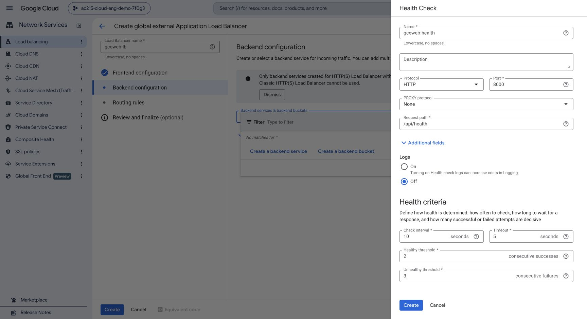

Save the health check and backend service. The 180-second backend timeout allows the bounded course-guide run to finish. The chat streams file reads and answer events. Keep API CDN disabled for this route.

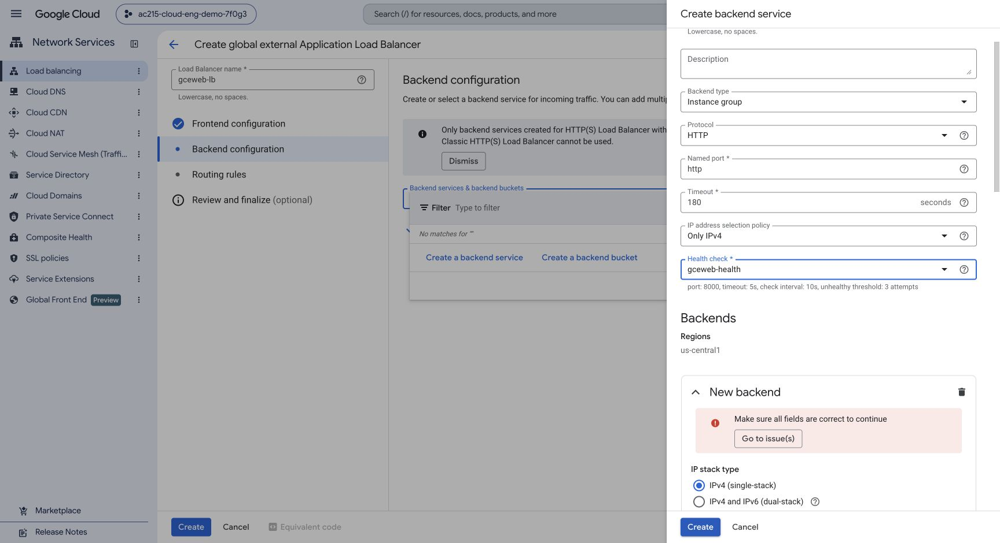

### Create the static backend bucket

Create a backend bucket:

| Field | Value |
| --- | --- |
| Name | `gceweb-static-backend` |
| Cloud Storage bucket | Your frontend bucket |
| Cloud CDN | Enabled |
| Cache mode | Use origin headers |
| Negative caching | Disabled |

Expand the backend bucket’s cache/advanced configuration and add these **custom response headers**:

| Header | Value |
| --- | --- |
| `X-Cache-Status` | `{cdn_cache_status}` |
| `X-Content-Type-Options` | `nosniff` |
| `Referrer-Policy` | `strict-origin-when-cross-origin` |
| `Content-Security-Policy` | `default-src 'self'; script-src 'self'; style-src 'self' 'unsafe-inline'; img-src 'self' data: blob:; font-src 'self'; connect-src 'self'; object-src 'none'; base-uri 'self'; frame-ancestors 'none'` |

Save. These headers are added on the load-balancer path. The bucket’s direct storage URLs remain public, so only public build files belong in it. [Custom response headers](https://docs.cloud.google.com/load-balancing/docs/https/custom-headers-global), [backend-bucket CDN settings](https://docs.cloud.google.com/cdn/docs/setting-up-cdn-with-bucket).

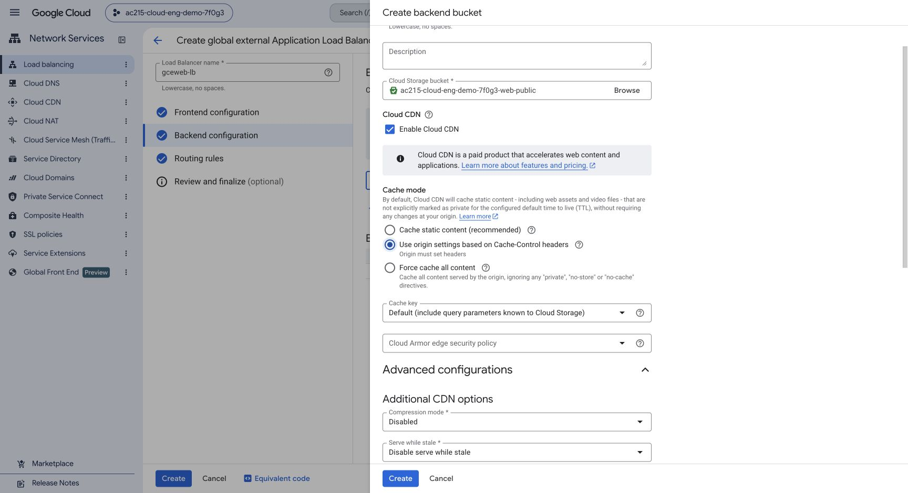

## Step 7: Configure routing and the HTTP frontend

In **Routing rules**, keep **Simple host and path rule**. Set:

| Host | Paths | Backend |
| --- | --- | --- |
| All unmatched (Default) | All unmatched (Default) | `gceweb-static-backend` |
| Your reserved ALB IPv4 | `/api` and `/api/*` | `gceweb-api-backend` |

Enter the two API paths separately, pressing Enter after each. Confirm they appear as two entries. Preserve the request path. The bucket is the default for all remaining paths.

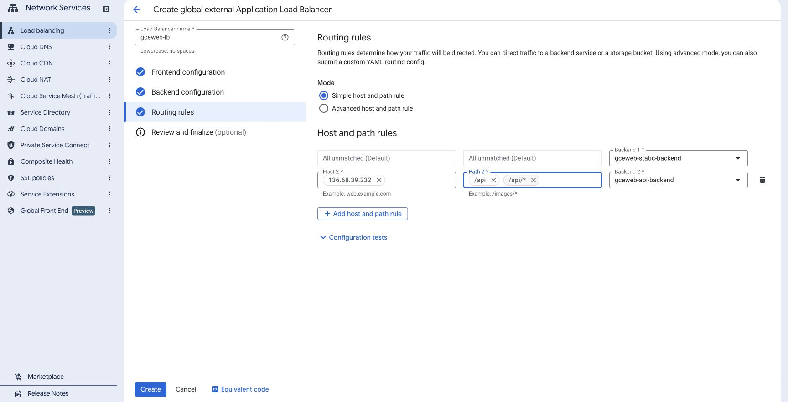

In **Frontend configuration**, enter:

| Field | Value |
| --- | --- |
| Name | `gceweb-http` |
| Protocol / IP version / port | HTTP / IPv4 / `80` |
| IP address | Reserved global `gceweb-ip` |

No certificate or DNS record is required. Review the configuration: bucket is the default, API paths use the VM backend, API CDN is disabled, static CDN is enabled, and no Cloud Armor policy is selected. Create the load balancer and wait for its public routing and backend health to become ready.

## Step 8: Verify the deployment

**Your computer**, replacing the placeholder with the ALB global IPv4:

```bash
curl -I http://YOUR_ALB_IPV4/
curl --fail http://YOUR_ALB_IPV4/api/health
curl --fail http://YOUR_ALB_IPV4/api/course
curl --fail --no-buffer http://YOUR_ALB_IPV4/api/chat/stream \
  -H 'Content-Type: application/json' \
  -d '{"question":"How do group late days work?"}'
```

Expect HTML 200 with `no-store`, health `{"status":"ok"}`, and course metadata reporting `provider: "gemini"`, `model: "gemini-3.8-flash"`, and `answer_mode: "model"`. A supported question should produce file-read events, `answer_delta` events, and a final answer with `mode: "model"`. In Console, confirm **HEALTHY** for the one VM backend. Open `http://YOUR_ALB_IPV4/` and use the browser checks in the verification guide.

The `gemini` argument selects the GCP provider through the VM service configuration. It uses the attached runtime account and requires the model API and IAM grant in the shared setup guide. No model key or secret `.env` file is needed. Use only non-sensitive public course questions over HTTP. Gemini requests incur GCP charges and share the same daily ledger when reusing the VM.

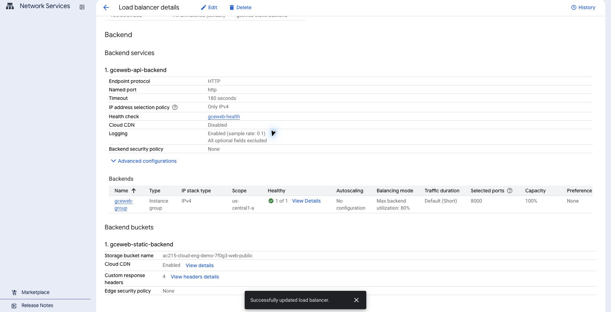

Follow [Verify the app](verify.md) to check static caching, a CDN cache hit, and blocked direct VM access. Finish with [Cleanup in Console](cleanup.md#option-b-alb-and-cdn).

## Update the app later

Push a new backend image tag, transfer the VM files again, and run the registry installer with the new digest. Publish the complete new frontend tree: upload new assets and other public files first, then replace all HTML files last; reapply their metadata. Retain earlier hashed assets while old browser tabs may still use them.
