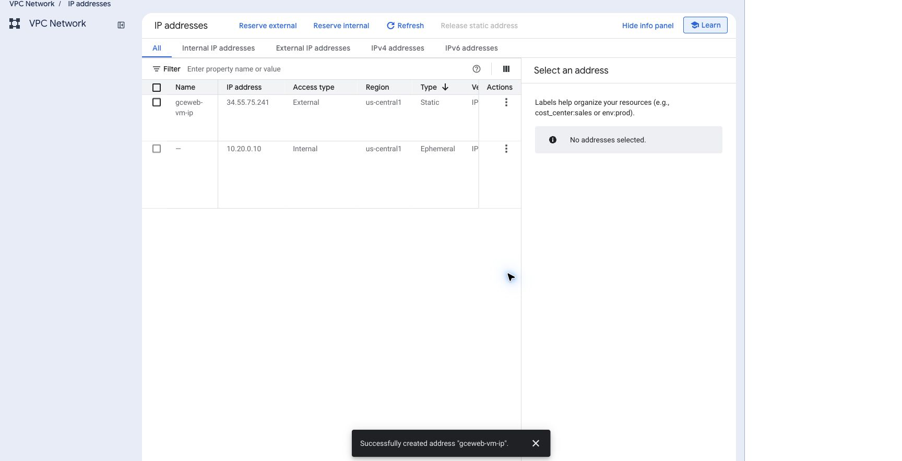
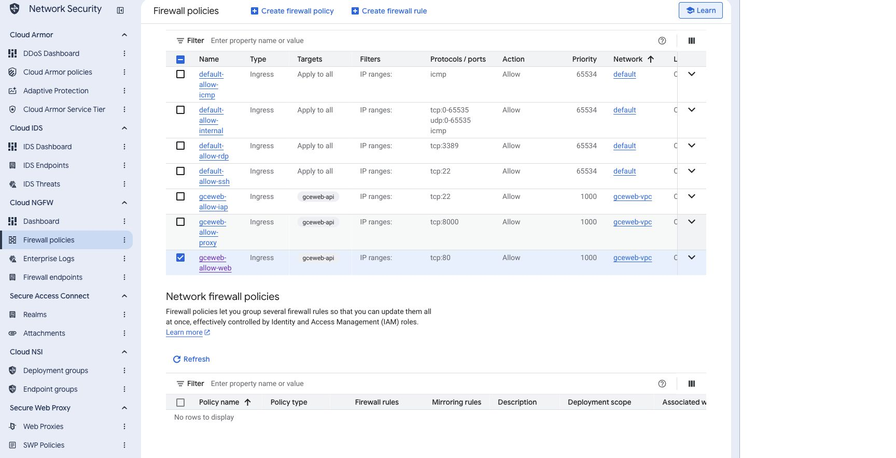

# Option A: Single Debian 13 VM with Nginx

[Back to the tutorial](../README.md)

Console screenshots illustrate the shared workflow. Your image digest, frontend filenames, and object count will differ. Follow the fields and complete-file checks in the text.

Nginx serves the frontend files and forwards `/api/...` to the backend container on the same VM. Nginx serves HTTP on port 80; the backend image comes from Artifact Registry.

```text
Browser → HTTP :80 → Nginx → frontend files
                            → /api/* → localhost:8000 → backend container
```

Before continuing, complete the [shared Console setup](provisioning.md), set `DEPLOYMENT_MODE=single-vm` in `config.env`, and [build/push the backend image](../README.md#step-4-build-and-push-the-backend-image). Examples use prefix `gceweb`.

## Step 1: Reserve the VM’s public address

**Console → VPC network → IP addresses:**

1. Find the ephemeral external IPv4 currently attached to `gceweb-api`.
2. Open its **View actions** menu and choose **Promote to static IP address**.
3. Name it `gceweb-vm-ip`, keeping its region `us-central1` and Premium network tier.
4. Confirm that the reserved address is still attached to the VM. Record the IPv4.

This is a regional VM address. It remains allocated until you release it during cleanup. [Reserve an existing address](https://docs.cloud.google.com/vpc/docs/reserve-static-external-ip-address).



## Step 2: Allow web traffic

**Console → VPC firewall rules → Create firewall rule:**

| Field | Value |
| --- | --- |
| Name | `gceweb-allow-web` |
| Network | `gceweb-vpc` |
| Priority | `1000` |
| Direction / action | Ingress / Allow |
| Target tags | `gceweb-api` |
| Source IPv4 ranges | `0.0.0.0/0` |
| Specified TCP ports | `80` |

Save. Port 80 is the public web entry for this deployment lab. The common IAP rule handles administrator access.

**Checkpoint:** The rule targets only the `gceweb-api` tag. Port 22 is allowed only by the IAP source rule, and no rule opens port 8000 to the internet. The backend will also bind to `127.0.0.1`, so Nginx is its web entry point.



## Step 3: Record the public address

Set `DOMAIN` in your local `config.env` to the reserved IPv4, without `https://` or a trailing slash. The variable stores the public host; it accepts an IPv4 address. No domain purchase or DNS record is required for this path.

```bash
DOMAIN=YOUR_RESERVED_IPV4
```

In the commands below, replace `YOUR_RESERVED_IPV4` with this address. The address is the public HTTP entry for this lab.

## Step 4: Transfer the VM configuration

**Your computer — tutorial folder:**

```bash
./scripts/upload-vm-files.sh
./scripts/ssh.sh
```

The first command sends a small configuration archive through IAP. It includes the frontend output you built in README Step 1 and the registry image reference, not the backend source or local credentials. The second opens the VM shell. Rebuild the frontend first if you changed its source.

**Inside the VM:**

```bash
mkdir -p ~/course-vm
tar -xzf ~/course-vm.tar.gz -C ~/course-vm
cat ~/course-vm/image-ref.txt
sudo bash ~/course-vm/vm/deploy-from-registry.sh \
  "$(cat ~/course-vm/image-ref.txt)" single-vm gemini
```

The [registry installer](scripts.md#backend-installation-deploy-from-registrysh-image-layout-gemini) creates a release directory, records the selected digest, and installs systemd settings. It obtains a short-lived token for the attached VM identity, pulls the exact image digest, installs the restricted systemd service, and starts the container. Temporary registry login files are removed. The container publishes its API on VM loopback at `127.0.0.1:8000` for Nginx.

The final `gemini` argument writes `COURSE_PROVIDER=gemini` into the service's configuration. The app uses that same attached identity to call Gemini 3.8 Flash at the global endpoint. No model key or secret `.env` file is needed. Confirm the API and runtime IAM grant from the shared guide before asking a question.

Look for:

```text
{"status":"ok"}
Registry image is running.
```

Check the selected image and port:

```bash
sudo docker inspect --format '{{.Config.Image}}' gce-web-api
sudo docker port gce-web-api
```

Expect the Artifact Registry reference ending in `@sha256:...`, and port 8000 mapped to `127.0.0.1:8000`. The VM pulled the image; it did not build it.

## Step 5: Install Nginx and read its configuration

**Inside the VM**, replace the placeholder with your reserved IPv4:

```bash
sudo bash /opt/gce-web/current/vm/install-nginx.sh YOUR_RESERVED_IPV4
sudo nginx -t
```

The [Nginx installer](scripts.md#frontend-installation-install-nginxsh-host) validates the supplied host, adds Nginx from Debian packages, copies the complete frontend build to `/var/www/ac215`, and installs the rendered [Nginx configuration](../vm/nginx.conf.in).

Open the active file:

```bash
sudo cat /etc/nginx/sites-available/ac215
```

Its important sections are:

| Setting | Effect |
| --- | --- |
| `server_name` | The reserved IPv4 you entered |
| `root /var/www/ac215` | Location of the public frontend files |
| API location + `proxy_pass http://127.0.0.1:8000` | Forward the original `/api/...` path to the backend |
| Forwarded Host and protocol headers | Preserve the original host and request protocol |
| `proxy_buffering off` for `/api/` | Deliver live server-sent file-read events without proxy buffering |
| `proxy_read_timeout 180s` | Bound the wait for an API response |
| `client_max_body_size` | Bound incoming API request bodies; the app accepts JSON questions |
| `/assets/` cache header | Cache content-hashed files for one year |
| Other static responses | Use `no-store` so reloads discover the current page |
| `try_files ... =404` | Return a real 404 for a missing path |

The [proxy module](https://nginx.org/en/docs/http/ngx_http_proxy_module.html) documents path forwarding, timeouts, and buffering. The supplied `ac215-security.conf` security snippet is included again where a location defines its own headers, following [Nginx header inheritance](https://nginx.org/en/docs/http/ngx_http_headers_module.html).

**Checkpoint:** `nginx -t` succeeds, and the following returns API health through Nginx:

```bash
curl --fail http://127.0.0.1/api/health
```

## Step 6: Verify HTTP delivery

Leave the VM shell before running the public-address checks.

**Inside the VM**

```bash
exit
```

**Your computer**, replacing the placeholder with the reserved VM IPv4:

```bash
curl -I http://YOUR_RESERVED_IPV4/
curl --fail http://YOUR_RESERVED_IPV4/api/health
curl --fail http://YOUR_RESERVED_IPV4/api/course
curl --fail --no-buffer http://YOUR_RESERVED_IPV4/api/chat/stream \
  -H 'Content-Type: application/json' \
  -d '{"question":"How do group late days work?"}'
```

Expect HTML with status 200 and `Cache-Control: no-store,max-age=0`, health `{"status":"ok"}`, and course metadata reporting `provider: "gemini"`, `model: "gemini-3.8-flash"`, and `answer_mode: "model"`. A supported question should produce file-read events, `answer_delta` events, and a final answer with `mode: "model"`. Open `http://YOUR_RESERVED_IPV4/` and use the browser checks in the verification guide.

Use only non-sensitive public course questions over HTTP. Requests to Gemini incur GCP charges and share the app's $10 daily allowance. See [course Q&A and budgeting](providers.md).

Follow [Verify the app](verify.md) and [VM operations](operations.md) for cache, firewall and container checks. To continue with Option B, use its transition steps and keep the VM. After your final layout, complete [Cleanup in Console](cleanup.md).

## Update the app later

On your computer, build/push a new image tag, then run `upload-vm-files.sh` again. Inside the VM, unpack the new archive and rerun the registry deployment command with its new digest.

To publish an updated frontend, rerun `install-nginx.sh` from the new `/opt/gce-web/current/` release. It preserves an existing site’s configuration and retains older hashed assets for open tabs. If you change the public address, update the Nginx `server_name` setting.
