# Create the shared resources in Google Cloud Console

[Back to the tutorial](../README.md)

Console screenshots illustrate the shared workflow. Your image digest, frontend filenames, and object count will differ. Follow the fields and complete-file checks in the text.

Use these steps for either deployment layout. Keep `config.env` open beside Console. Examples use prefix **`gceweb`**, region **`us-central1`**, and zone **`us-central1-a`**. If you chose another prefix or location, use it consistently in every field.

## Step 1: Create the project, enable billing, and set a budget

**Console:**

1. Open the project selector → **New project**. Create a dedicated project, or select the empty project supplied by your administrator.
2. Copy its **project ID**, not its display name, into `PROJECT_ID` in `config.env`.
3. Open **Billing** and link the authorized billing account. Confirm the selected project is linked.
4. Open **Billing → Budgets & alerts**. Create an alerts-only budget scoped to this project, with your estimate and a monitored email address.
5. Complete the [cost worksheet](cost-worksheet.md) for your selected layout and record a cleanup time.

An alerts-only budget reports spend; it does not stop resources. [Google’s budget behavior](https://docs.cloud.google.com/billing/docs/how-to/budgets).

## Step 2: Enable the APIs

Use Console search to open **APIs & Services → Library**. Find and enable:

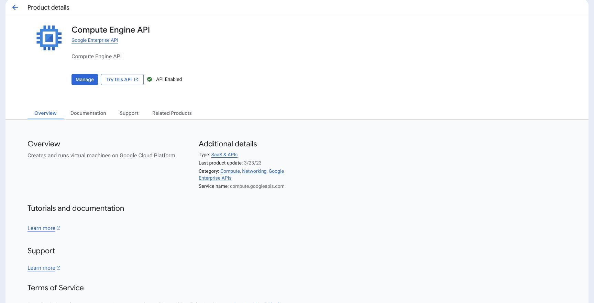

| API | Purpose |
| --- | --- |
| Compute Engine API | VM, VPC, firewall, instance group, and load balancing |
| Identity and Access Management (IAM) API | Service-account setup |
| IAM Service Account Credentials API | Impersonate the SSH identity |
| Cloud Resource Manager API | Project lookup used by the CLI |
| Agent Platform API / Vertex AI API (`aiplatform.googleapis.com`) | Gemini inference using the attached VM identity |
| Service Usage API | Service availability and permissions |
| Cloud Identity-Aware Proxy API | IAP SSH tunnel |
| Artifact Registry API | Store the backend image |
| Cloud Logging API | Inspect cloud service logs |

For Option B, also enable the **Cloud Storage API**. Return to the same project after each API page; the project name appears in the top bar.

The IAP API page also lists Chrome Enterprise Premium pricing. This exercise uses IAP TCP forwarding to a Google Cloud VM, which has no extra IAP charge. It does not require a Chrome Enterprise Premium subscription. VM and applicable network charges still apply. [IAP pricing](https://cloud.google.com/iap/pricing).

For Gemini, search for **`aiplatform.googleapis.com`**. Console currently labels this **Agent Platform API**. Open its product page and click **Enable**. If the API is already enabled, continue.

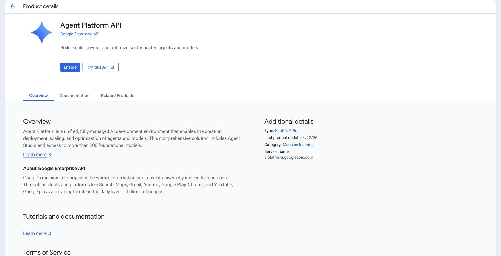

**Checkpoint:** The APIs show **Enabled** in this project.

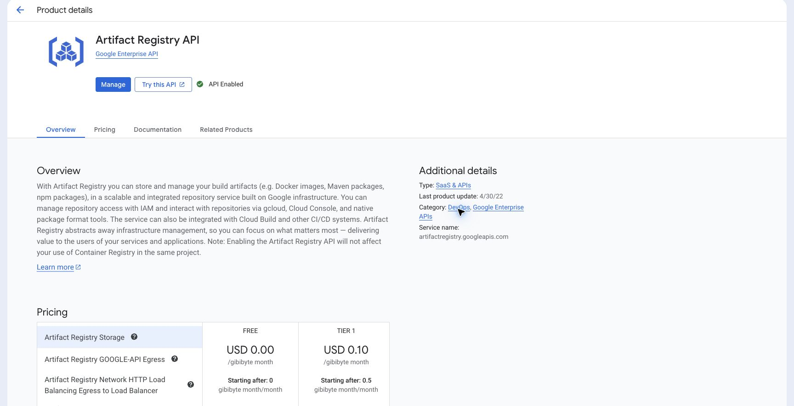

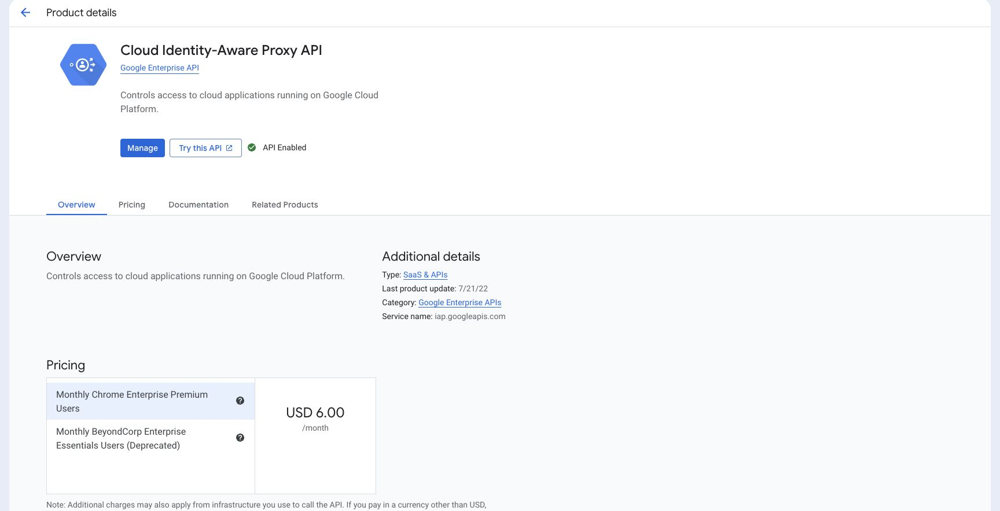

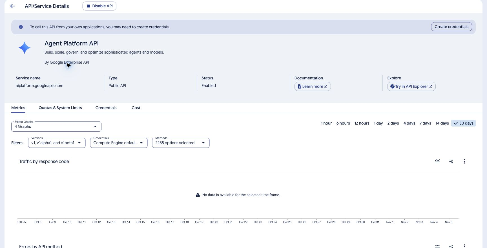

## Step 3: Create the three service accounts

Open **IAM & Admin → Service Accounts → Create service account**. Create each account below. Leave project-role grants empty in the account-creation wizard; add the scoped grants in the following steps.

| Account ID | Email pattern | Purpose |
| --- | --- | --- |
| `gceweb-access` | `gceweb-access@PROJECT_ID.iam.gserviceaccount.com` | Local image push and caller authentication for IAP SSH |
| `gceweb-ssh` | `gceweb-ssh@PROJECT_ID.iam.gserviceaccount.com` | Keyless identity used for the VM login |
| `gceweb-api` | `gceweb-api@PROJECT_ID.iam.gserviceaccount.com` | Identity attached to the VM; pulls the backend image and invokes Gemini |

Use the first email as `ACCESS_SERVICE_ACCOUNT` in `config.env`. The helpers derive the other two from `PREFIX`.

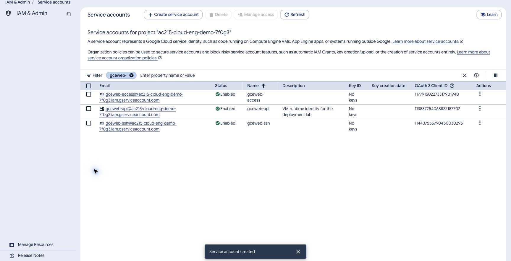

### Allow the local account to impersonate the SSH account

1. Open the **`gceweb-ssh` service account → Principals with access → Grant access**.
2. Principal: the **`gceweb-access` email**.
3. Role: **Service Account Token Creator**.
4. Save.

This grant is on the SSH account itself. It allows the local account to request short-lived credentials for that different identity. [Service-account SSH](https://docs.cloud.google.com/compute/docs/connect/set-up-service-account-ssh).

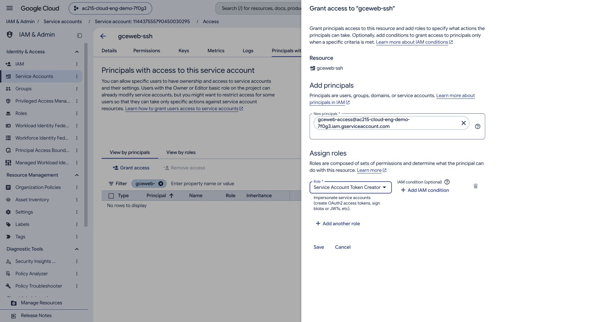

### Give the SSH identity OS Login and lookup permissions

Open **IAM & Admin → IAM → Grant access**:

- Principal: the **`gceweb-ssh` email**.
- Roles: **Compute Viewer** and **Compute OS Admin Login**.
- Scope: this dedicated lab project.

Compute Viewer lets the CLI find the VM. OS Admin Login lets the Linux account use `sudo`. These project-level grants apply within this dedicated project. [OS Login role requirements](https://docs.cloud.google.com/compute/docs/oslogin/set-up-oslogin).

### Allow the SSH identity to use the VM runtime account

1. Open **`gceweb-api` service account → Principals with access → Grant access**.
2. Principal: the **`gceweb-ssh` email**.
3. Role: **Service Account User**.
4. Save.

OS Login checks this when connecting to a VM with an attached service account. The account used in Console must also have permission to attach `gceweb-api` when creating the VM; your administrator can grant that if needed.

### Create the local access key

1. Open **`gceweb-access` → Keys → Add key → Create new key**.
2. Choose **JSON** and download it.
3. On your computer, create `secrets/` in this tutorial folder and move the file to `secrets/gcp-service-account.json`.

The folder is Git-ignored. Create no downloaded keys for `gceweb-ssh` or `gceweb-api`. If organization policy prevents key creation, resolve the approved access method with your administrator before continuing.

## Step 4: Create the Artifact Registry repository

**Console → Artifact Registry → Repositories → Create repository:**

| Field | Value |
| --- | --- |
| Name | `gceweb-images` |
| Format | **Docker** |
| Mode | **Standard** |
| Location type | **Region** |
| Region | `us-central1` |
| Encryption | Google-managed key |
| Vulnerability scanning | Disabled for this cost-controlled lab; leave Container Scanning API off |

Create the repository. Its image prefix will be:

```text
us-central1-docker.pkg.dev/PROJECT_ID/gceweb-images
```

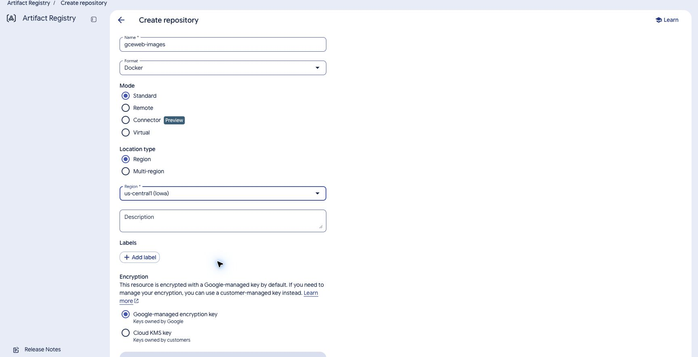

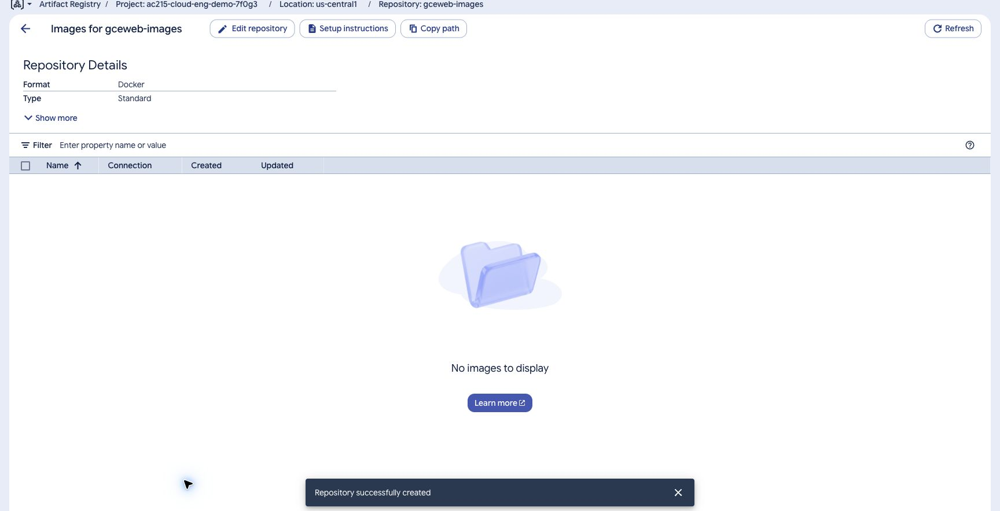

Open the repository’s **Permissions** panel and grant:

| Principal | Role on this repository |
| --- | --- |
| `gceweb-access@PROJECT_ID.iam.gserviceaccount.com` | **Artifact Registry Writer** |
| `gceweb-api@PROJECT_ID.iam.gserviceaccount.com` | **Artifact Registry Reader** |

The local account pushes the image. The attached VM identity can pull it. Repository-scoped grants keep those jobs separate. [Create a repository](https://docs.cloud.google.com/artifact-registry/docs/repositories/create-repos), [repository permissions](https://docs.cloud.google.com/artifact-registry/docs/access-control).

**Checkpoint:** The Docker repository exists in the chosen region and its permission panel shows both grants.

### Allow the VM identity to invoke Gemini

Open **IAM & Admin → IAM → Grant access**.

1. Enter the `gceweb-api@PROJECT_ID.iam.gserviceaccount.com` principal.
2. Add the role with ID **`roles/aiplatform.user`**. Console may label it **Vertex AI User** or **Agent Platform User**.
3. Save and confirm the grant on this dedicated project.

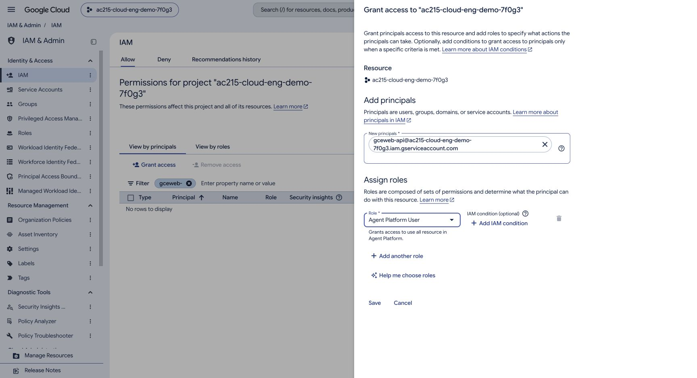

This role includes `aiplatform.endpoints.predict` for model requests. Keep the repository Reader grant as well. The existing VM account does both jobs. Gemini needs no additional service account or downloaded key. The VM's cloud-platform access scope is set in Step 7. [Model access permissions](https://docs.cloud.google.com/vertex-ai/generative-ai/docs/access-control), [VM workload authentication](https://docs.cloud.google.com/compute/docs/access/authenticate-workloads).

## Step 5: Create the VPC and subnet

Use Console search to open **VPC networks → Create VPC network**:

| Field | Value |
| --- | --- |
| Name | `gceweb-vpc` |
| Subnet creation mode | **Custom** |
| Subnet name | `gceweb-subnet` |
| Region | `us-central1` |
| IPv4 range | `10.20.0.0/24` |
| Dynamic routing mode | **Regional** |

Create the network with that one subnet. Leave the optional predefined firewall-rule selections clear; you will add the lab’s named rules explicitly.

The VPC is global. This subnet is regional. The VM will be in a zone within that region.

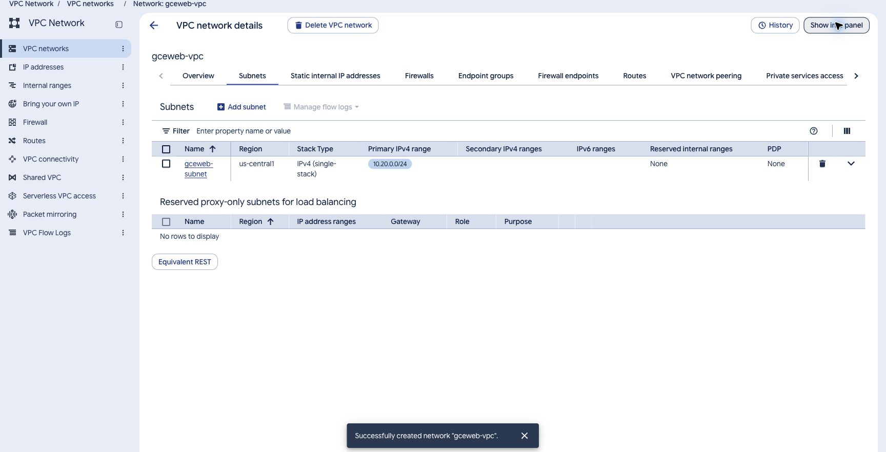

## Step 6: Create the IAP firewall rule

Open **VPC firewall rules → Create firewall rule**:

| Field | Value |
| --- | --- |
| Name | `gceweb-allow-iap` |
| Network | `gceweb-vpc` |
| Priority | `1000` |
| Direction / action | **Ingress / Allow** |
| Targets | **Specified target tags**: `gceweb-api` |
| Source filter | **IPv4 ranges** |
| Source ranges | `35.235.240.0/20` |
| Protocols and ports | **Specified protocols and ports → TCP: `22`** |
| Logs | Enabled |

Save. This rule allows the IAP tunnel to reach the tagged VM’s SSH port. IAM permissions are a separate check. [IAP TCP forwarding](https://docs.cloud.google.com/iap/docs/using-tcp-forwarding).

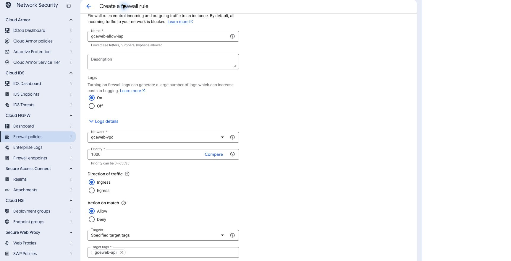

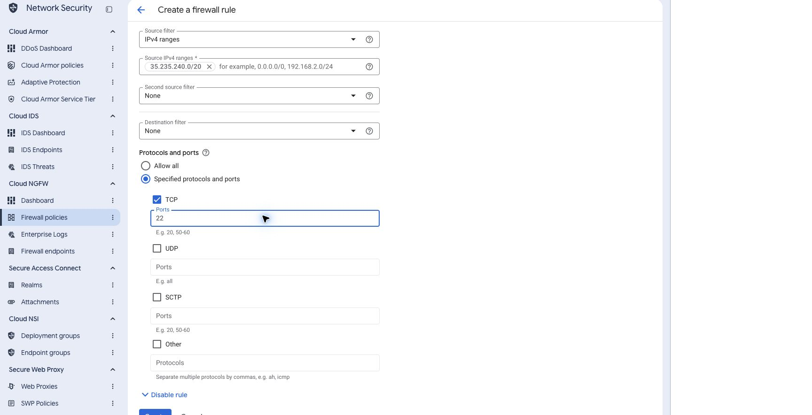

Your selected layout guide adds the web/API firewall rule after this shared setup.

**Stop here before creating the VM.** Complete [Configure the local account](access.md#configure-the-local-account), then [README Step 4](../README.md#step-4-build-and-push-the-backend-image) to build and push the backend image. Confirm the generic `backend` image and digest in Artifact Registry, then return for Step 7. This delays starting the billable VM until it is needed.

## Step 7: Create the Debian 13 VM

Open **Compute Engine → VM instances → Create instance**. Enter:

| Field | Value |
| --- | --- |
| Name | `gceweb-api` |
| Region / zone | `us-central1` / `us-central1-a` |
| Machine family / type | General purpose E2 / **e2-medium** |
| Boot disk | **Debian GNU/Linux 13**, standard persistent disk, **20 GB** |
| Service account | **`gceweb-api`**, the runtime identity |
| Access scopes | **Allow full access to all Cloud APIs** |
| Network tags | `gceweb-api` |
| Network / subnetwork | `gceweb-vpc` / `gceweb-subnet` |
| Primary internal IPv4 | Custom: **`10.20.0.10`** |
| External IPv4 | Ephemeral, Premium tier; Option A promotes it to a static address |
| Automatic HTTP/HTTPS firewall checkboxes | Leave clear; use the selected guide’s named rule |

The access scope is the API-access ceiling. IAM grants the VM identity **Reader on your image repository** and **`roles/aiplatform.user`** for Gemini in the project. Confirm both grants from Step 4. [Compute Engine registry access](https://docs.cloud.google.com/artifact-registry/docs/integrate-compute).

Under **Data protection**, select **No backups** for this disposable lab. Do not keep valuable data on this VM; configure backups before longer use. Under **Observability**, clear **Install Ops Agent** for this short validation run. Basic VM metrics remain available without the agent.

Under **Security**, keep Shielded VM vTPM and integrity monitoring enabled, and enable **Secure Boot** for this Debian image. Expand **Manage access**. Check **Block project-wide SSH keys**, then enable **Control VM access through IAM permissions** (OS Login). Leave **Require 2-step verification** clear for this service-account login workflow. After OS Login is enabled, the project-key checkbox can remain checked and disabled.

In **Advanced → Metadata**, add:

| Key | Value |
| --- | --- |
| `serial-port-enable` | `FALSE` |

Open the local [vm/startup.sh](../vm/startup.sh) file in a text editor. Copy all its text, starting with `#!/usr/bin/env bash`. In **Advanced → Automation → Startup script**, paste that complete text, then create the VM.

The startup script updates OS packages, enables unattended security updates, configures SSH login settings, installs Docker Engine, and prepares the release directory. Read [each startup step and its completion marker](scripts.md#vm-preparation-startupsh). A required reboot can still remain after package updates; the [operations guide](operations.md) explains the checks. Debian 13 is available as a GCP image family and supported by Docker. [GCP images](https://docs.cloud.google.com/compute/docs/images), [Docker Debian support](https://docs.docker.com/engine/install/debian/).

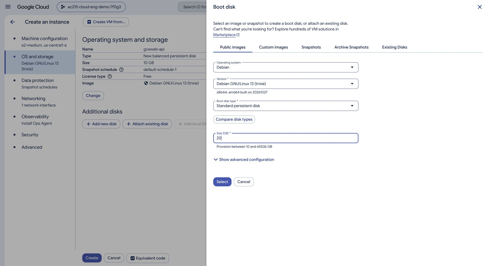

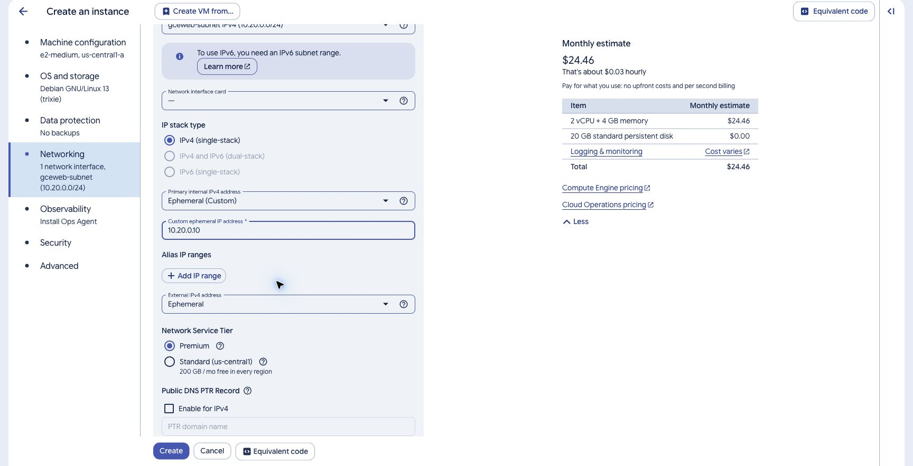

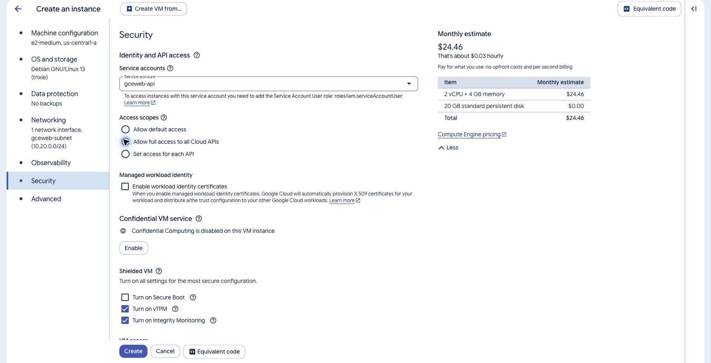

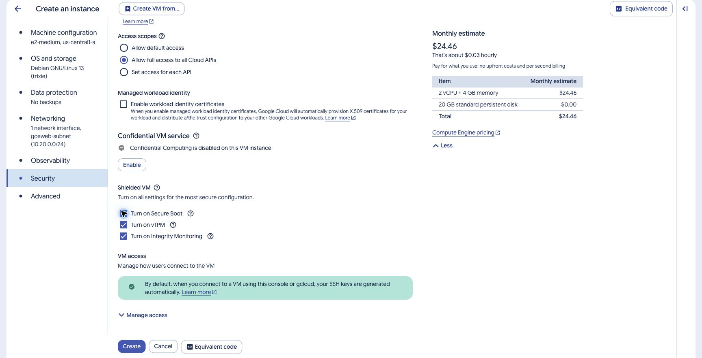

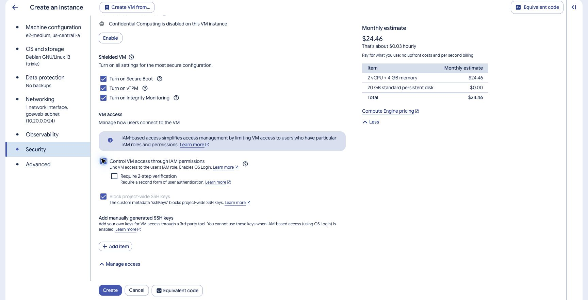

**Checkpoint:** The VM is running in the expected zone with internal IP `10.20.0.10`, the runtime service account, and the `gceweb-api` tag.

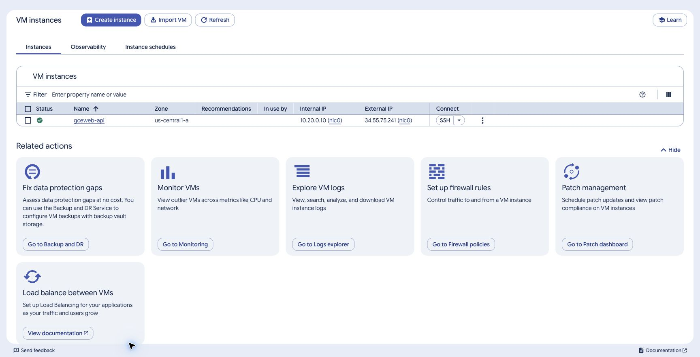

## Step 8: Grant IAP access to the SSH identity

1. Open **Security → Identity-Aware Proxy** using Console search.
2. Select **SSH and TCP resources**.
3. Select the `gceweb-api` VM and show its permissions/info panel.
4. Choose **Add principal**. Principal: the **`gceweb-ssh` email**.
5. Role: **IAP-secured Tunnel User**.
6. Add a condition named `ssh-port-22`, using the condition editor:

```text
destination.port == 22
```

7. Save the grant on this selected VM.

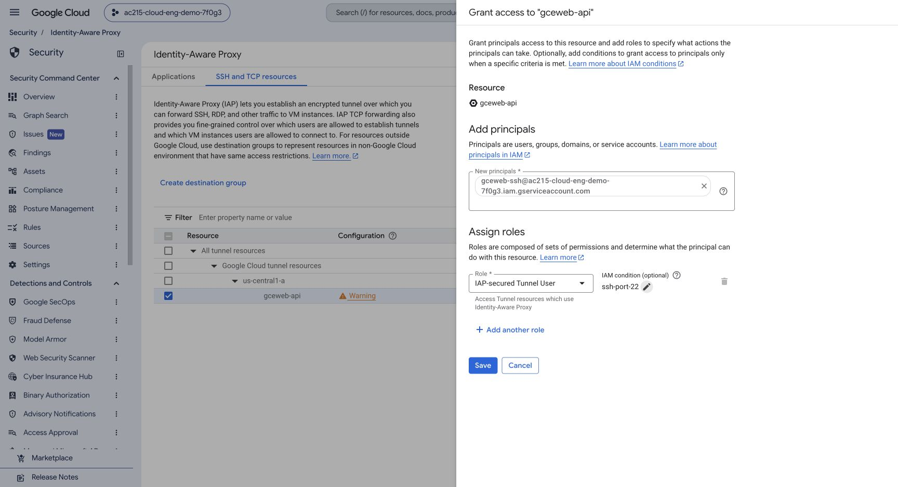

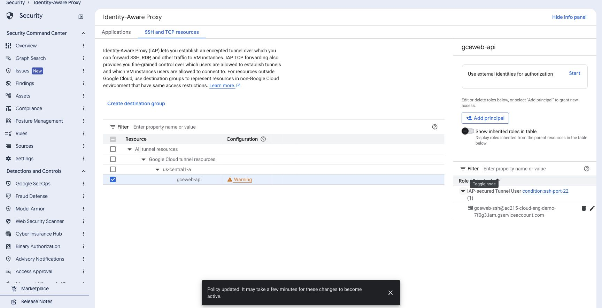

This binds tunnel access to the VM you selected and to port 22. [Console steps for IAP access](https://docs.cloud.google.com/iap/docs/using-tcp-forwarding).

## Step 9: Connect from your computer

Follow [local access and IAP SSH](access.md), then run:

```bash
./scripts/00-auth.sh
./scripts/ssh.sh
```

**Inside the VM:**

```bash
cat /etc/os-release
test -f /var/lib/gce-web-bootstrap.ready && echo 'Bootstrap ready'
sudo docker version
```

The first helper activates the configured local account; the second opens an IAP SSH shell as the keyless SSH identity. See [authentication](scripts.md#local-authentication-00-authsh) and [SSH](scripts.md#vm-connection-sshsh).

Expect Debian **13**, **Bootstrap ready**, and Docker client/server information. The VM can show Running while its startup script is still installing packages. If the marker is absent, inspect startup:

```bash
sudo journalctl -u google-startup-scripts.service -n 80 --no-pager
sudo tail -n 80 /var/log/gce-web-bootstrap.log
```

If installation is still progressing, wait for it to finish and rerun the checkpoint commands. If the log shows an error, resolve it using [troubleshooting](troubleshooting.md) before deploying the image.

Type `exit` to return to your computer, then continue with [Option A](deploy-single-vm.md) or [Option B](deploy-alb-cdn.md). The backend image is already in Artifact Registry.
